# Manual del desarrollador — Reportería MR LANA

Documento técnico **único** del sistema. Instalación rápida y requisitos en el
[`README.md`](../README.md). Contrato de la API en [`api-openapi.yaml`](api-openapi.yaml).
Estado al 23-nov-2026.

Contenido:

1. [Qué es y principios](#1-qué-es-y-principios)
2. [Arquitectura](#2-arquitectura)
3. [Flujo de datos y modelo de periodos](#3-flujo-de-datos-y-modelo-de-periodos)
4. [Modelo de datos (diagramas entidad-relación)](#4-modelo-de-datos-diagramas-entidad-relación)
5. [Actores y casos de uso](#5-actores-y-casos-de-uso)
6. [Módulos](#6-módulos)
7. [Flujos principales y estados](#7-flujos-principales-y-estados)
8. [API v1](#8-api-v1)
9. [Colas, jobs y scheduler](#9-colas-jobs-y-scheduler)
10. [Notificaciones](#10-notificaciones)
11. [Seguridad, permisos y roles](#11-seguridad-permisos-y-roles)
12. [Despliegue en el VPS](#12-despliegue-en-el-vps)
13. [Catálogo de comandos artisan](#13-catálogo-de-comandos-artisan)
14. [Frontend](#14-frontend)
15. [Pruebas](#15-pruebas)
16. [Pendientes y bugs conocidos](#16-pendientes-y-bugs-conocidos)
17. [Glosario de negocio](#17-glosario-de-negocio)

---

## 1. Qué es y principios

Reportería MR LANA recibe cada mes los archivos operativos de la empresa (nómina NOI, Lendus:
ministraciones, ingresos de cobranza, saldos por cliente, gastos y directorio; ERP: gastos) y
produce la **radiografía financiera** por sucursal, por colaborador y consolidada. Sobre esos
mismos números se construyen el Dashboard, el comparativo entre periodos, el Estado de
Resultados, los OKR y la API para otros sistemas.

Principios que el código respeta y que **no deben romperse**:

- **Una sola fuente de verdad por cifra.** La radiografía sale de
  `RadiographySnapshotBuilder` / `BranchRadiographyCalculator`, expuesta por
  `RadiografiaExportService::buildSnapshot()`. La web, el Excel, el PDF, el Dashboard, OKR y la
  API leen ese snapshot y **nunca recalculan** por su cuenta. En el Estado de Resultados la
  fuente única es `EstadoResultadosDatasetBuilder`, y el hash del dataset se imprime en web,
  Excel y PDF.
- **Nunca inventar un cero.** Si no hay dato (sin radiografía, sin cartera, KPI no atribuible),
  se devuelve `null` con un estado explícito (`not_available`, `not_attributable`, «Pendiente»).
- **Los registros viven en un solo periodo.** Cada fila `fact_*` lleva `period_id` (el mes
  operativo en que se cargó). Las vistas por semana o por mes natural son **agrupaciones por
  fecha** de las mismas filas: nada se copia ni se mueve.
- **Migraciones aditivas.** Las migraciones solo crean tablas, columnas o índices (los `drop`
  están en `down()`). La versión anterior del código funciona con el esquema nuevo.
- **Todo en español** (UI, mensajes, comandos, documentación), con confirmaciones SweetAlert2 y
  UX guiada por pasos.

## 2. Arquitectura

Monolito Laravel 13 con frontend Vue 3 servido por Inertia (sin SSR). Todo corre en un VPS
Ubuntu: Nginx, PHP-FPM 8.4, MySQL 8 (InnoDB), un worker de colas con Supervisor y el
scheduler por cron.

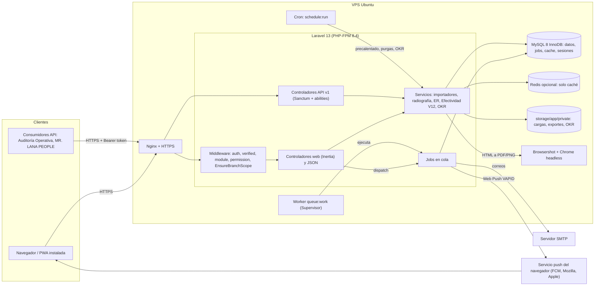

Capas en el código:

| Capa | Dónde | Notas |
|---|---|---|
| Rutas | `routes/web.php` (incluye `okr.php` y `settings.php`), `routes/api.php`, `routes/console.php` | Todo `web.php` (salvo SEO) va en `auth` + `verified`. |
| Middleware | `app/Http/Middleware` | Ver sección 11. Alias: `module`, `permission`, `ensure.ability`, `log.api-query` (`bootstrap/app.php`). |
| Controladores | `app/Http/Controllers` (`Api/V1`, `Okr`, `Settings`) | Los más grandes (`MonthlyReportController`, `ReportUploadController`) tienen 1,400-2,000 líneas. |
| Servicios | `app/Services/**` | Toda la lógica de negocio. Subcarpetas por módulo (sección 6). |
| Jobs | `app/Jobs` | Cola `default` de la conexión `database` (sección 9). |
| Modelos | `app/Models` (+ `EstadoResultados/`, `ExpenseReview/`) | Eloquent. |
| Vistas Blade | `resources/views` | `app.blade.php` (shell Inertia y SEO), plantillas de PDF en `reports/`, documentación de API en `docs/api.blade.php`. |
| Frontend | `resources/js` | Vue 3 + TypeScript + Tailwind 4 + shadcn-vue (sección 14). |
| Configuración propia | `config/company.php`, `efectividad.php`, `efectividad_rutas.php`, `estado_resultados.php`, `pdf.php`, `radiografia.php`, `seo.php`, `webpush.php` | |

Configuración propia (`config/`):

| Archivo | Para qué |
|---|---|
| `company.php` | Datos corporativos (razón social PRODUCTOS Y SERVICIOS MR LANA S.A.P.I. DE C.V., ciudad…) para los documentos OKR. |
| `efectividad.php` | Umbrales del job de Efectividad V4 (heredado). |
| `efectividad_rutas.php` | Catálogo ruta → sucursal de la calculadora (la «Oficina» de Lendus es la ruta). |
| `estado_resultados.php` | Tamaño máximo de importación, caché y cola del precalentado de comparativas. |
| `pdf.php` | Browsershot: rutas de Node, npm y Chrome, timeout, sandbox, espera de `__PDF_READY__`. |
| `radiografia.php` | Caché de la corrida general (TTL, candado, espera) y precalentado. |
| `seo.php` | Páginas públicas indexables (login, recuperar contraseña) y verificación de Google. |
| `webpush.php` | Claves VAPID y modelo `PushSubscription`. |

## 3. Flujo de datos y modelo de periodos

### 3.1 Del archivo al reporte

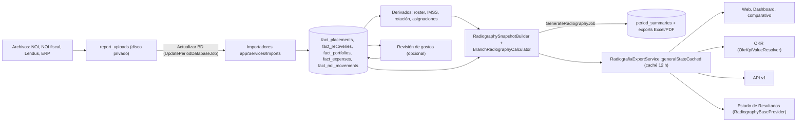

### 3.2 Periodos

Tabla `periods`, modelo `App\Models\Period`. Tipos (`type`): `weekly`, `monthly`, `bimonthly`,
`quarterly`, `semiannual`, `annual`.

- **Semana** (`weekly`): lunes a domingo (código `W-2026-23`). Es metadata organizativa.
- **Mes operativo** (`monthly`): agrupa **cuatro semanas** (28 días, 20 jornadas) en
  `component_period_ids`. Es el **único** periodo que recibe cargas
  (`Period::canReceiveUploads()`: mensual y con semanas componentes). Todas las filas `fact_*` y
  la radiografía se etiquetan con el mes operativo. Ejemplo: «Junio 2026» = semanas 22-25,
  del 25-may al 21-jun. La pertenencia de una semana al mes es **esa lista**, nunca el campo
  `month` ni el nombre de la semana («Semana 22 - Mayo 2026» pertenece a Junio).
- **Agrupados** (bimestre, trimestre, semestre, año): agrupan meses por `component_period_ids`.
  No reciben cargas. Para cartera/mora se usa el **último mes componente**
  (`Period::resolveLastMonthlyComponent()`).
- **Nombre manual** (`custom_name`, máx. 120): en Periodos → lápiz «Cambiar nombre» (permiso
  `periodos · crear`). Solo cambia la etiqueta (`label` en web, Excel, PDF y API); `name`,
  `code`, `id`, fechas y relaciones quedan intactos y el generador nunca lo toca. Vacío o igual
  al del sistema regresa al nombre del sistema; no puede repetirse dentro del mismo tipo. Se
  registra en el log (`periodos.renombrar`). Los archivos ya generados conservan el nombre
  anterior hasta regenerarse.
- **Cierre**: `is_closed` (Periodos → cerrar/abrir, `PeriodCloseGuardService` decide si se
  puede). Al crear un mes nuevo se notifica (sección 10).
- **Meses naturales** (1 al último día): solo existen en la API (`/calendar-months`). Se arman
  filtrando las filas por su **fecha propia** (`operation_date`, `payment_date`,
  `expense_date`, `movement_date`) a través de los periodos que tocan ese mes. Como cada fila
  vive en un solo periodo no hay duplicados. Ejemplo: abril natural 2026 = 1-26 abr del periodo
  «Abril 2026» (30-mar → 26-abr) + 27-30 abr del periodo «Mayo 2026» (27-abr → 24-may).

Servicios: `PeriodGenerationService`, `WeeklyPeriodGeneratorService` (comando
`periods:generate-weekly`), `PeriodCloseGuardService`.

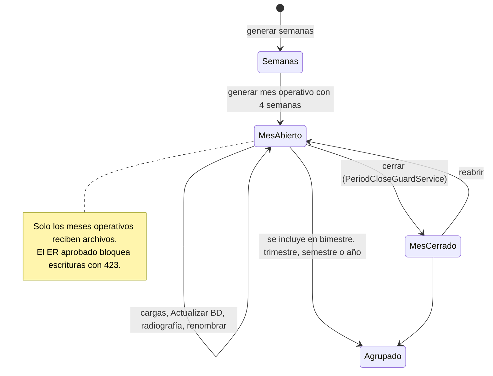

## 4. Modelo de datos (diagramas entidad-relación)

Esquema obtenido de las 133 migraciones de `database/migrations` y comprobado contra la base
local en solo lectura (94 tablas, más `push_subscriptions` y `user_notification_preferences`,
que en local seguían pendientes de migrar). Los diagramas muestran las llaves primarias y
foráneas y las columnas clave, no todas las columnas.

> **Claves foráneas e InnoDB.** Las FK de los diagramas se crean solo con InnoDB. En una base
> MyISAM (el WAMP local por defecto) no existe ninguna FK física y las transacciones no
> protegen nada. Las relaciones marcadas «lógica» no tienen constraint en ningún motor: son
> columnas `*_id` que el código usa como referencia.

### 4.1 Núcleo: periodos, cargas, catálogos, colaboradores y hechos

```mermaid
erDiagram
    periods {
        bigint id PK
        varchar code UK
        varchar name
        varchar custom_name "nombre manual, null = del sistema"
        varchar type "weekly, monthly, bimonthly, quarterly, semiannual, annual"
        smallint year
        tinyint month
        smallint sequence
        date start_date
        date end_date
        json component_period_ids
        boolean is_closed
    }
    data_sources {
        bigint id PK
        varchar code UK
        varchar name
        boolean is_active
        boolean is_required_for_bd
        boolean is_required_for_report
    }
    report_uploads {
        bigint id PK
        bigint period_id FK
        bigint data_source_id FK
        bigint uploaded_by FK
        varchar original_name
        varchar stored_path "ruta relativa en disco privado"
        varchar status "pending, processed, database_updated, failed"
        json covered_period_ids
        date snapshot_date
    }
    process_runs {
        bigint id PK
        bigint period_id FK
        bigint report_upload_id FK
        varchar process_type
        varchar status
        int rows_read
        int rows_inserted
    }
    sucursales {
        bigint id PK
        varchar codigo UK
        varchar nombre
        varchar region "Q1 o Q3"
        boolean activa
    }
    branches {
        bigint id PK
        varchar code UK
        bigint sucursal_id FK
        varchar name
        varchar normalized_name
        boolean is_active
    }
    branch_aliases {
        bigint id PK
        bigint branch_id FK
        varchar alias UK
        varchar scope
    }
    employees {
        bigint id PK
        varchar employee_code "clave NOI, NO es unica"
        varchar full_name
        varchar normalized_name
        varchar position
        varchar source_system
        boolean is_active
    }
    employee_aliases {
        bigint id PK
        bigint employee_id FK
        varchar normalized_alias
        varchar source
    }
    employee_match_rejections {
        bigint id PK
        varchar pair_key UK
        bigint employee_id_a FK
        bigint employee_id_b FK
    }
    employee_branch_assignments {
        bigint id PK
        bigint period_id FK
        bigint employee_id FK
        bigint branch_id FK
        varchar match_type
        decimal confidence
        boolean was_manual_reviewed
    }
    period_employee_rosters {
        bigint id PK
        bigint period_id FK
        bigint employee_id FK
        varchar movement_type "alta, baja, activo, sin_cambio"
        boolean is_active_for_period
        boolean requires_review
    }
    fact_placements {
        bigint id PK
        bigint period_id FK
        bigint report_upload_id FK
        bigint branch_id FK
        bigint financial_product_id FK
        varchar promoter_name
        decimal amount
        date operation_date
    }
    fact_recoveries {
        bigint id PK
        bigint period_id FK
        bigint report_upload_id FK
        bigint branch_id FK
        varchar contract
        decimal total_amount
        date payment_date
        boolean is_savehearts
    }
    fact_portfolios {
        bigint id PK
        bigint period_id FK
        bigint report_upload_id FK
        bigint branch_id FK
        varchar contract
        decimal balance
        int days_past_due
        date portfolio_date
    }
    fact_expenses {
        bigint id PK
        bigint period_id FK
        bigint report_upload_id FK
        bigint employee_id FK
        bigint branch_id FK
        varchar category
        varchar concept
        decimal amount
        date expense_date
    }
    fact_noi_movements {
        bigint id PK
        bigint period_id FK
        bigint employee_id FK
        bigint report_upload_id FK
        varchar concept
        varchar concept_type
        decimal amount
        date movement_date
    }
    fact_imss {
        bigint id PK
        bigint period_id FK
        bigint branch_id "logica"
        int collaborators_count
        decimal amount
    }
    fact_rotacion {
        bigint id PK
        bigint period_id FK
        bigint report_upload_id FK
        bigint branch_id "logica"
        int altas
        int bajas
        decimal indice_rotacion
    }
    financial_products {
        bigint id PK
        varchar code UK
        varchar name
    }

    periods ||--o{ report_uploads : "recibe"
    data_sources ||--o{ report_uploads : "tipo de archivo"
    report_uploads ||--o{ process_runs : "bitacora de lectura"
    periods ||--o{ process_runs : ""
    sucursales ||--o{ branches : "agrupa rutas"
    branches ||--o{ branch_aliases : "alias"
    employees ||--o{ employee_aliases : "alias"
    employees ||--o{ employee_match_rejections : "no fusionar"
    periods ||--o{ employee_branch_assignments : ""
    employees ||--o{ employee_branch_assignments : "sucursal del periodo"
    branches ||--o{ employee_branch_assignments : ""
    periods ||--o{ period_employee_rosters : "roster NOI"
    employees ||--o{ period_employee_rosters : ""
    report_uploads ||--o{ fact_placements : "genera"
    report_uploads ||--o{ fact_recoveries : "genera"
    report_uploads ||--o{ fact_portfolios : "genera"
    report_uploads ||--o{ fact_expenses : "genera"
    report_uploads ||--o{ fact_noi_movements : "genera"
    periods ||--o{ fact_placements : ""
    periods ||--o{ fact_recoveries : ""
    periods ||--o{ fact_portfolios : ""
    periods ||--o{ fact_expenses : ""
    periods ||--o{ fact_noi_movements : ""
    periods ||--o{ fact_imss : ""
    periods ||--o{ fact_rotacion : ""
    branches ||--o{ fact_placements : ""
    branches ||--o{ fact_recoveries : ""
    branches ||--o{ fact_portfolios : ""
    branches ||--o{ fact_expenses : ""
    financial_products ||--o{ fact_placements : "producto"
    employees ||--o{ fact_noi_movements : "nomina"
    employees ||--o{ fact_expenses : "gasto atribuido"
```

Otras tablas del núcleo, sin dibujar: `lendus_employee_directory` (directorio Lendus →
`report_uploads`, `branches`), `period_branch_exclusions`, `period_employee_movement_reviews`
(decisiones sobre bajas), `employee_period_manual_expenses`, `employee_external_identities`
(vínculo explícito con sistemas externos, sin poblar), `fact_period_employee_summary`
(`UNIQUE (period_id, employee_id)`).

Reglas que el esquema hace cumplir:

- `periods`: `UNIQUE code` y `UNIQUE (type, year, month, sequence)`. No hay columna de estado:
  se usa `is_closed`.
- `employee_branch_assignments` y `period_employee_rosters`: una fila por colaborador y periodo.
- `employees.employee_code` **no es único** (el índice único se quitó el 23-jul-2026): dos
  personas pueden compartir clave NOI.
- `fact_noi_movements`: `UNIQUE (report_upload_id, source_row_key)` evita importar dos veces la
  misma fila.

### 4.2 Procesos y radiografía

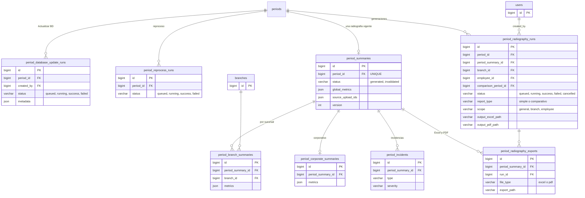

### 4.3 Efectividad de cobranza

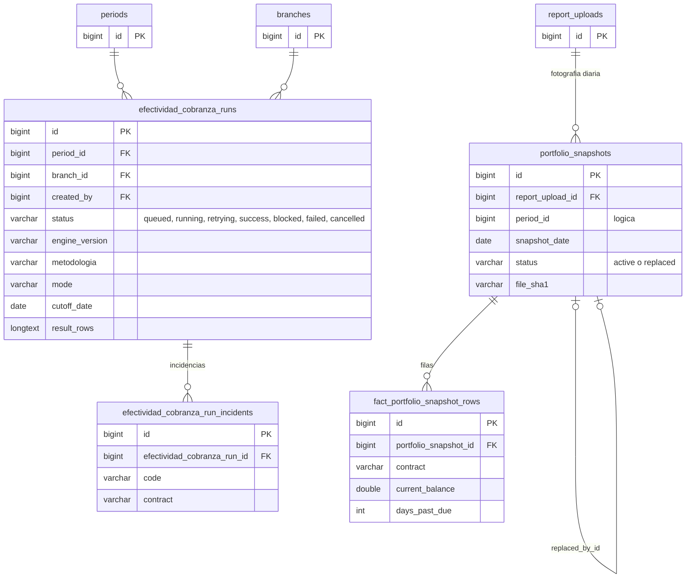

Estas tablas son del flujo **anterior** (V4 en segundo plano). La calculadora vigente (V12.9.4)
**no escribe en la base de datos** (sección 6.6).

### 4.4 Estado de Resultados

```mermaid
erDiagram
    periods ||--o{ estado_resultados_uploads : "estados de cuenta"
    estado_resultados_uploads ||--o{ estado_resultados_movements : "movimientos"
    estado_resultados_uploads ||--o{ estado_resultados_import_attempts : "intentos"
    estado_resultados_import_attempts ||--o{ estado_resultados_import_errors : "errores"
    periods ||--o{ estado_resultados_payroll_uploads : "NOI corporativo"
    estado_resultados_payroll_uploads ||--o{ estado_resultados_payroll_lines : "lineas"
    periods ||--o{ estado_resultados_classifications : "clasificacion manual"
    periods ||--o{ estado_resultados_adjustments : "ajustes"
    estado_resultados_adjustments ||--o{ estado_resultados_adjustment_logs : "bitacora"
    periods ||--o{ estado_resultados_runs : "procesamientos"
    periods ||--o{ estado_resultados_reconciliation_links : "conciliacion"
    periods ||--o{ estado_resultados_versions : "versiones aprobadas"
    estado_resultados_versions ||--o{ estado_resultados_version_snapshots : "dataset por alcance"
    estado_resultados_versions ||--o{ estado_resultados_version_logs : "bitacora"
    periods ||--o{ estado_resultados_exports : "Excel y PDF"
    periods ||--o{ estado_resultados_tasks : "tareas en cola"
    estado_resultados_concept_rules ||--o{ estado_resultados_concept_rule_logs : "bitacora"
    estado_resultados_concept_rules |o--o{ estado_resultados_movements : "concept_rule_id logica"
    estado_resultados_credits ||--o{ estado_resultados_amortization_uploads : "tabla de amortizacion"
    estado_resultados_amortization_uploads ||--o{ estado_resultados_amortization_rows : "pagos"

    estado_resultados_uploads {
        bigint id PK
        bigint period_id FK
        varchar account_slot "administrativa o excedentes"
        tinyint file_part "archivo 1 o 2"
        char file_hash
        varchar status "cargado, procesado, reemplazado"
        varchar lifecycle "recibido ... conciliado, rechazado, duplicado"
    }
    estado_resultados_movements {
        bigint id PK
        bigint upload_id FK
        bigint period_id FK
        bigint recognition_period_id "logica"
        date movement_date
        decimal cargo
        decimal abono
        varchar fingerprint
        varchar auto_treatment
        varchar reconciliation_state
    }
    estado_resultados_versions {
        bigint id PK
        bigint period_id FK
        int version
        varchar status "aprobado o sustituido"
        bigint current_period_id "UNIQUE, una vigente por periodo"
        varchar dataset_hash
    }
    estado_resultados_version_snapshots {
        bigint id PK
        bigint version_id FK
        varchar scope_key
        longtext dataset
    }
    estado_resultados_adjustments {
        bigint id PK
        bigint period_id FK
        varchar scope_key
        varchar concept
        varchar state "sin_informacion, confirmado_cero, capturado"
        decimal amount
    }
    estado_resultados_reconciliation_links {
        bigint id PK
        bigint period_id FK
        varchar target_type "erp, noi, banco"
        varchar link_kind
        varchar match_type
        decimal applied_amount
    }
    estado_resultados_tasks {
        bigint id PK
        bigint period_id FK
        varchar kind "procesar o aprobar"
        varchar status "queued, running, ok, error"
        int progress_percent
    }
    estado_resultados_concept_rules {
        bigint id PK
        varchar match_text
        varchar match_mode "contiene, empieza, exacto"
        varchar treatment
        int priority
    }
    estado_resultados_credits {
        bigint id PK
        varchar key UK "lerom, bbva"
        varchar adjustment_concept
    }
    estado_resultados_amortization_uploads {
        bigint id PK
        bigint credit_id FK
        varchar status "vigente o sustituida"
    }
    estado_resultados_amortization_rows {
        bigint id PK
        bigint upload_id FK
        date payment_date
        decimal interest
    }
    estado_resultados_payroll_uploads {
        bigint id PK
        bigint period_id FK
        varchar status
    }
    estado_resultados_payroll_lines {
        bigint id PK
        bigint upload_id FK
        varchar concept_type "percepcion o deduccion"
        decimal amount
    }
    estado_resultados_import_attempts {
        bigint id PK
        bigint upload_id FK
        varchar status
    }
    estado_resultados_import_errors {
        bigint id PK
        bigint attempt_id FK
    }
    estado_resultados_classifications {
        bigint id PK
        bigint period_id FK
        varchar treatment
    }
    estado_resultados_adjustment_logs {
        bigint id PK
        bigint adjustment_id FK
    }
    estado_resultados_runs {
        bigint id PK
        bigint period_id FK
        varchar status "ok o error"
    }
    estado_resultados_version_logs {
        bigint id PK
        bigint version_id FK
        varchar action
    }
    estado_resultados_exports {
        bigint id PK
        bigint period_id FK
        varchar format "pdf o xlsx"
    }
    estado_resultados_concept_rule_logs {
        bigint id PK
        bigint rule_id "logica"
    }
    periods {
        bigint id PK
    }
```

Reglas del esquema: `estado_resultados_movements` tiene `UNIQUE (period_id, fingerprint,
dedup_key)` (un movimiento bancario no entra dos veces); `estado_resultados_versions` tiene
`UNIQUE (period_id, version)` y `UNIQUE current_period_id` (una sola versión vigente por
periodo); `estado_resultados_adjustments` tiene `UNIQUE (period_id, scope_key, concept)`.

### 4.5 OKR

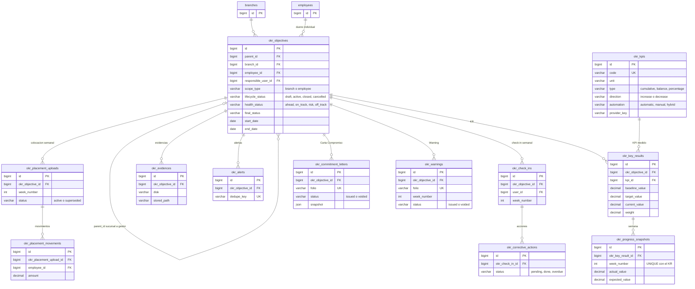

También existen: `okr_audit_logs` (polimórfica sobre objetivo o KR), `okr_settings` (umbrales
del semáforo y rangos de cierre, `key` único con valor JSON) y `okr_branch_reconciliations`.

### 4.6 Usuarios, roles, permisos y API

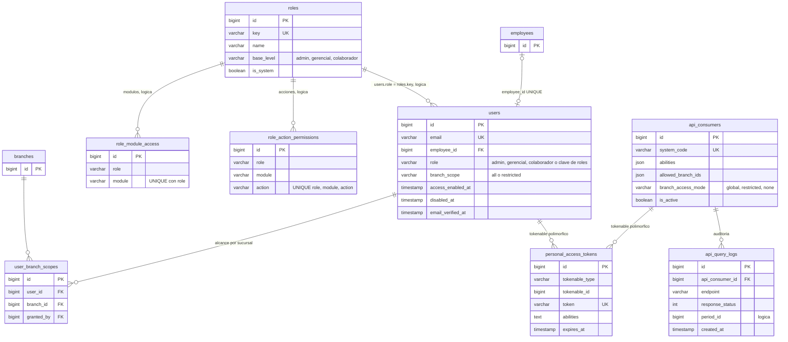

Los tres roles de sistema (`admin`, `gerencial`, `colaborador`) y sus permisos por defecto **no
salen de un seeder**: los insertan las migraciones `2026_10_14_120000`, `2026_10_16_000002`,
`2026_10_17_100100` y `2026_10_27_000001` con `insertOrIgnore`.

### 4.7 Revisión de gastos y notificaciones

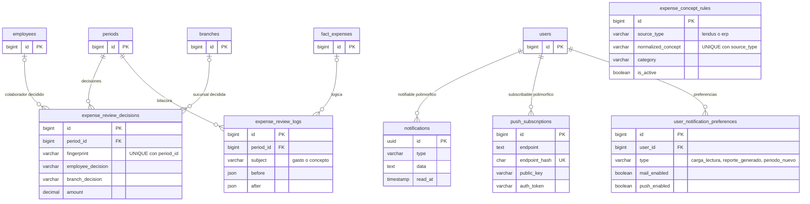

Tablas del framework: `cache` y `cache_locks` (candados de `Cache::lock()`), `jobs`,
`job_batches`, `failed_jobs`, `sessions`, `password_reset_tokens` y `migrations`.

## 5. Actores y casos de uso

Los roles de sistema son `admin`, `gerencial` y `colaborador`. Se pueden crear roles
personalizados que heredan el nivel de `gerencial` o `colaborador`, y cada rol tiene su
matriz de módulos y acciones (sección 11). Los diagramas muestran lo que cada rol tiene **por
defecto**.

### 5.1 Administrador

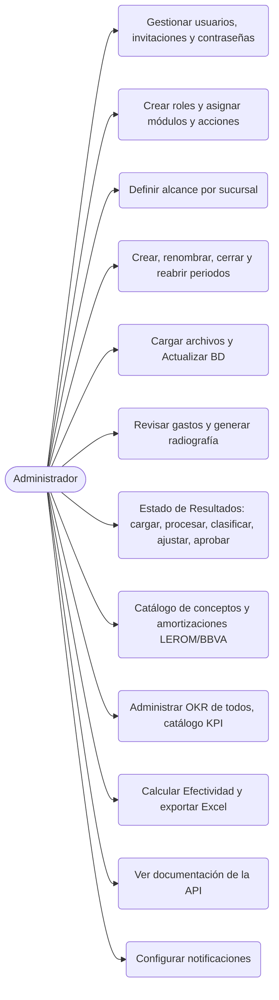

### 5.2 Gerencial

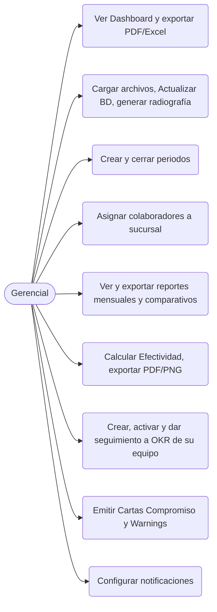

Un gerencial con alcance restringido por sucursal pierde los módulos de alcance general
(`carga`, `periodos`, `estado_resultados`) y solo ve sus sucursales.

### 5.3 Colaborador

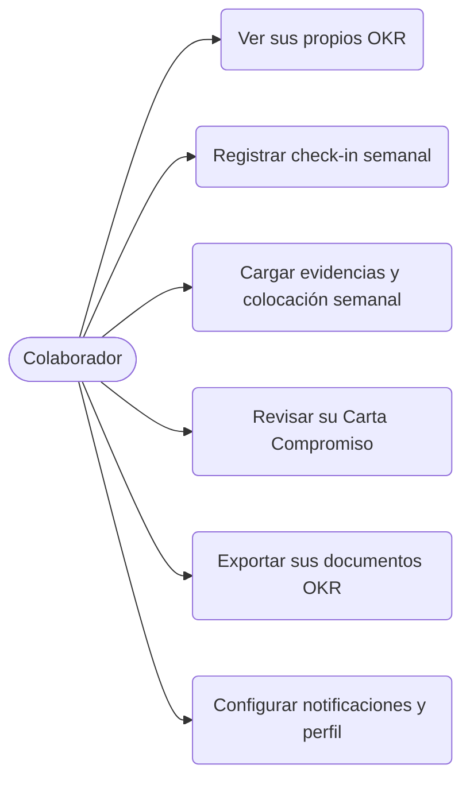

El acceso a OKR exige además `users.access_enabled_at` (middleware `EnsureOkrAccessEnabled`)
y, para objetivos individuales, el vínculo `users.employee_id`.

### 5.4 Consumidor API

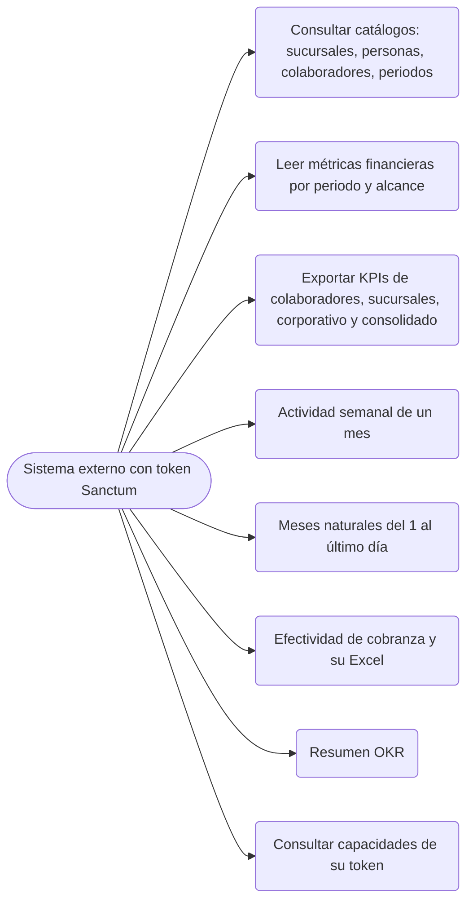

---

## 6. Módulos

### 6.1 Periodos

- **Ruta**: `/periodos` (`module:periodos`; `periodos,{crear,eliminar,cerrar}`).
- **Controlador**: `PeriodController` (`index`, `store`, `PATCH {p}/nombre`, `destroy`,
  `close`, `open`).
- **Servicios**: `PeriodGenerationService`, `WeeklyPeriodGeneratorService`,
  `PeriodCloseGuardService`.
- **Página**: `pages/Periodos/Index.vue` (composable `usePeriodosIndex`).
- Reglas en la sección 3.2.

### 6.2 Carga de archivos (Histórico General) y «Actualizar BD»

- **Ruta**: `/historico-general` (`module:carga`; `carga,{subir,eliminar,descargar,procesar,generar}`).
- **Controlador**: `ReportUploadController`. Subir, analizar, descargar el original, eliminar,
  Actualizar BD (cancelar, limpiar, progreso, procesar ahora, reencolar), incidencias,
  personas sin sucursal, coincidencias, generar radiografía (progreso, cancelar) y reprocesar
  fuentes.
- **Página**: `pages/historico-general/index.vue`, pasos en `components/historico-general/`
  (`DatabaseUpdateStep`, `IncidentsStep`, `GenerateReportStep`, `GeneratedReportActions`…).
- **Fuentes** (`data_sources`, `DataSourceSeeder`): `noi_nomina`, `noi_nomina_fiscal`,
  `lendus_ministraciones`, `lendus_ingresos_cobranza`, `lendus_saldos_cliente`,
  `lendus_saldos_cliente_foto`, `gastos_lendus` (PDF), `gastos_lendus_excel`, `gastos_erp`,
  `lendus_empleados`, `imss` y `rotacion` (heredadas: hoy IMSS y rotación se derivan de NOI) y
  `gastos` (heredada, inactiva). `is_required_for_bd` / `is_required_for_report` deciden qué
  bloquea cada paso.
- **Almacenamiento**: `App\Support\ReportUploadStorage` es el único acceso a los archivos.
  `store()` guarda siempre en el disco privado `local` (`storage/app/private/reports/...`);
  `exists()`/`path()` buscan primero en el privado y después en el público heredado;
  `delete()` borra de ambos. `report_uploads.stored_path` es relativo e igual en los dos
  discos. Comando para migrar archivos viejos: `reportes:mover-cargas-a-privado`.
- **Flujo**: `ReportUploadService` registra el archivo y, al reemplazar uno de la misma fuente,
  `PeriodDerivedDataCleaner::clearForUpload()` borra las filas `fact_*` del anterior.
  «Actualizar BD» crea un `period_database_update_runs` y despacha `UpdatePeriodDatabaseJob`,
  que llama a `DatabaseUpdateService`: para cada archivo `ReportAnalysisService` elige el
  importador y deja un `process_runs`. Después reconstruye derivados (roster NOI, IMSS y
  rotación derivados de NOI fiscal, asignaciones automáticas).
- **Importadores** (`app/Services/Imports`): `NoiNominaImportService`,
  `LendusMinistracionesImportService`, `LendusIngresosCobranzaImportService`,
  `LendusSaldosClienteImportService`, `LendusCarteraFotoImportService`,
  `LendusEmployeeDirectoryImportService`, `GastosErpExcelImportService`,
  `GastosLendusExcelImportService`, `GastosLendusPdfImportService` (con
  `Support/PdfCoordinateExtractor`), `ImssExcelImportService`, `RotacionExcelImportService`
  (heredados) y `GastosImportService` (heredado). `ColumnMapService` define las columnas
  autorizadas de cada fuente Lendus: los importadores son estrictos con los encabezados.
- **Concurrencia**: «Actualizar BD» y «Generar radiografía» bloquean la fila del periodo
  (`lockForUpdate`, requiere InnoDB). El job solo reclama runs en `queued`: una re-entrega de la
  cola sobre un run `running` sale sin hacer nada.

### 6.3 Revisión de gastos (opcional)

Paso opcional entre «Actualizar BD» y «Generar radiografía» para corregir a qué colaborador o
sucursal se atribuye un gasto y la categoría de un concepto.

- **Rutas**: `/historico-general/{period}/revision-gastos` (+ `/opciones`, `/conceptos`,
  `/{expense}/bitacora`, `POST /decisiones`, `POST /conceptos`). Lectura con `module:carga`;
  escritura con `carga,procesar`.
- **Controlador**: `ExpenseReviewController`. **Servicios**: `ExpenseReviewQuery` (lectura) y
  `ExpenseReviewService` (escritura). **Frontend**:
  `components/historico-general/expense-review/useExpenseReview.ts`.
- **Tablas**: `expense_review_decisions` (una decisión por gasto, `UNIQUE (period_id,
  fingerprint)`), `expense_concept_rules` (regla por concepto y fuente), `expense_review_logs`
  (bitácora antes/después).
- Un usuario restringido solo ve y edita gastos de sus sucursales; corporativo, «sin sucursal»
  y las reglas por concepto exigen alcance general. Si la migración no está aplicada responde
  503 con un mensaje.
- La atribución automática previa vive en `OpexClassificationService` (fuente única de
  clasificación OPEX), `ExpenseObservationAttributionService` (por Observación/Justificación),
  `GastosExcelBranchResolverService` y `FinanciamientoMotosAssignmentService`.

**Actualizar un reporte ya generado con clasificaciones (regeneración rápida).** Si el
reporte del periodo ya existe y después se clasifican gastos, al guardar aparece el botón
«Actualizar reporte con clasificaciones». Envía la misma generación
(`POST /historico-general/{periodo}/generar-radiografia`) con `config.regeneracion_rapida = true`:

- El controlador la rechaza si esa identidad de reporte nunca se generó (primero va una generación completa).
- `GenerateRadiographyJob` quita la marca del config (el cálculo y las exportaciones reciben la
  configuración de siempre) y **omite** los pasos 3 (revisión de asignaciones de sucursal), 3b
  (gastos Excel y motos) y 3c (atribución OPEX por observación): los registros no cambiaron y las
  decisiones ya se aplicaron al guardar. Sí recalcula métricas (paso 1), aplica decisiones (3d),
  consolida por empleado (4) y genera Excel y PDF (5 y 6). Mismo run, progreso y notificaciones.
- Periodos cerrados no admiten cambios en la revisión (hay que reabrirlos). Los Excel/PDF ya
  descargados no cambian: se descargan otra vez. Pruebas: `tests/Feature/QuickRegenerationTest.php`.

### 6.4 Colaboradores (asignación a sucursal, roster)

- **Rutas**: `/asignaciones-empleado-sucursal` (pendientes, match automático, conciliar
  movimientos del periodo, match manual) y `/empleados` (asignar sucursal en lote, puesto).
  `module:colaboradores`; `colaboradores,{editar,conciliar}`.
- **Controladores**: `EmployeeBranchAssignmentController`, `EmployeeController`.
- **Servicios de identidad**: `PersonIdentityResolverService`, `CanonicalEmployeeResolver`,
  `EmployeeNameCanonicalizer` (nombre normalizado sin acentos; variantes de captura con
  Levenshtein ≤ 2), `EmployeeBranchAutoMatchService`, `BranchResolverService`.
  `employee_match_rejections` impide fusionar homónimos marcados.
- **Roster** (`app/Services/Roster`): `PeriodEmployeeRosterService` arma el roster canónico del
  mes desde NOI (altas, bajas, activos); `RosterMovementReviewService` registra la conciliación
  de bajas (`period_employee_movement_reviews`); `EmploymentEligibilityPolicy` separa el
  **acceso** al sistema del **estado laboral**.
- **Sucursales**: `App\Services\Catalog\BranchRouteCatalog` es el catálogo oficial ruta →
  sucursal (13 sucursales operativas en `branches`, 11 institucionales de OKR en `sucursales`
  vía `branches.sucursal_id`). `OperativeBranchService` lista las operativas.
- **Página**: `pages/AsignacionSucursal/Index.vue` (`components/asignaciones/`).

### 6.5 Radiografía, reportes mensuales, Dashboard y validaciones

- **Rutas**: `/reportes-mensuales` (`module:reportes`; `reportes,{editar,exportar}`,
  `colaboradores,exportar`): índice, comparativo (y sus datos), vista previa, `scoped-data`,
  saldo inicial de caja, `radiografia.xlsx`/`.pdf`, export filtrado, `colaboradores.xlsx`,
  `consolidado.csv`, descargas por run. `/dashboard` (`module:dashboard`;
  `/dashboard/exportar.pdf` y `.xlsx` con `reportes,exportar`). `/validaciones`.
- **Controladores**: `MonthlyReportController`, `DashboardController`, `ValidationController`.
- **Servicios** (`app/Services/Radiography`): `RadiographySnapshotBuilder` (snapshot completo
  del periodo, ~7,800 líneas), `BranchRadiographyCalculator` (por sucursal, ~5,200 líneas;
  contiene `recoveryExclusionSql()`, la regla oficial de recuperación),
  `RadiographyWorkbookBuilder` (Excel sobre `resources/templates/radiografia_template.xlsx`),
  `RadiographyChartSvgBuilder`, `ProductNormalizerService`, `EmployeesHistoricoExportService`
  (Excel de colaboradores). Fuera de esa carpeta: `PeriodRadiographyService`,
  `RadiografiaExportService` (Excel/PDF y estado general en caché), `DashboardTrendService`,
  `Dashboard/DashboardExcelExporter`, `Dashboard/DashboardPdfChartBuilder`.
- **Generación**: «Generar radiografía» crea un `period_radiography_runs` (identidad: periodo,
  tipo `simple`/`comparativo`, alcance `general`/`branch`/`employee`) y despacha
  `GenerateRadiographyJob`: summary, automatch, motos, consolidación, Rotación/IMSS, Excel, PDF
  y registro en `period_radiography_exports`. Al terminar, `WarmDashboardTrendCacheJob`
  recalienta la tendencia del Dashboard y se notifica al usuario.
- **Alcance**: `applyScope()` filtra **todo** el reporte por sucursal o colaborador;
  `ReportVisibilityService` aplica `reportes,ver_propios` / `ver_todos`.
- **Caché**: `RadiografiaExportService::generalStateCached()` guarda la corrida general 12 h
  con `Cache::lock` por clave; `radiografia:precalentar` la mantiene caliente para los 3 meses
  más recientes (sección 9). El comparativo se cachea 12 h.

Reglas de negocio clave (validadas contra cifras reales; **no cambiar sin conciliar un periodo
completo** con `reportes:audit-cuadre` y las auditorías del catálogo):

| Concepto | Regla vigente |
|---|---|
| Colocación | KPI **bruto**: DESEMBOLSO + REFINANCIAMIENTO de `fact_placements`. El seguro se muestra como dato informativo y **no se resta**. |
| Recuperación | Solo transacciones PAGO y DESCUENTO (`recoveryExclusionSql()`); seguros fuera (100 %), CRECE/Savehearts reconoce solo el **30 %**, UNIFICACIÓN y CONDONACIÓN excluidas. |
| Cartera | Saldo de «Saldos por cliente» al cierre; **cartera vencida** = contratos con DPD > 0 (buckets 0-30 … 120+, 121-180 y 180+ se agrupan en 120+), sin Aguascalientes. Mora % = vencida ÷ cartera. |
| OPEX | ERP (filtrado solo por sucursal) + Lendus, sin fondeos, excedentes, pólizas ni nómina. Gasolina, finiquitos, médicos y motos se reclasifican a Nómina/Capital Humano. Gastos de Corporativo excluidos del OPEX de sucursal. |
| Nómina y Capital Humano | Percepciones NOI (neto) + IMSS patronal + gastos de nómina de empleados. Colaboradores sin sucursal operativa van a CORPORATIVO (hoja «SIN ASIGNAR»). |
| EBITDA de la radiografía | Ingreso base − (OPEX + Nómina y Capital Humano); categoría (JUNIOR, SENIOR…) con `RadiographyStyleHelper::ebitdaCategory()`. EBITDA consolidado = Σ sucursales + aporte corporativo (diferencia 0). |
| Fondeo y excedentes | Préstamos entre sucursales (`interbranch_loans`) y envío de utilidad a corporativo: informativos, no son OPEX. |
| Ajuste manual de gasto por colaborador | **Efímero**: no se guarda en BD ni altera exportes (`TemporaryOpexAdjustmentService`). `EmployeePeriodManualExpenseService` está desconectado del cálculo: no usarlo. |
| Dato informativo vs KPI | Se muestra siempre bruto y ajuste como líneas separadas, nunca solo el neto. |

### 6.6 Efectividad de cobranza

- **Ruta**: `/efectividad-cobranza` (`module:efectividad`; `efectividad,{calcular,exportar,
  exportar_excel}`). Colaborador: 403 en todo el módulo.
- **Controlador vigente**: `EfectividadCalculadoraController` (calculadora **temporal y
  síncrona**): subir archivos a un espacio de trabajo (`calculadora/archivos`), quitar o limpiar,
  calcular (`throttle:30,1`), vista, exportar PDF/PNG y Excel (`throttle:20,1`).
- **Servicios**: `Efectividad/Calculadora/EfectividadCalculadoraService` (modalidades, mensual,
  historial, filtros), `EfectividadWorkspace`, `EfectividadExcelReader` (con protección contra
  bombas ZIP), `EfectividadExportService` (PDF/PNG), `EfectividadCalculadoraExcelExporter`.
  Motor: `Efectividad/V12/EfectividadV12Calculator` y sus clases `V12*`.
- **Sin base de datos**: los archivos se guardan **cifrados con `APP_KEY`** en
  `storage/app/private/efectividad-tmp/` (el Excel original se borra al leerlo) con TTL de 60
  min. Se purgan con «Limpiar», al salir, cada 10 min (`efectividad:limpiar-temporales`) y las
  descargas usan `deleteFileAfterSend`. En la UI nunca se dice «macro».

**Metodología V12.9.4** (`EfectividadV12Calculator::METODOLOGIA`, motor
`mrlana-v12.9.4-2026-11`, «APORTE POR BUCKET CONTRA SANO»). Paridad verificada contra el libro
de referencia de Córdoba (semana 26-oct a 01-nov-2026): 348/348 valores de la hoja, 8,613/8,613
filas de amortización y 1,010/1,010 contratos conciliados.

| Tema | Regla |
|---|---|
| Entradas | Fotografías «Saldos por Cliente» (0 = domingo base, 1-6 = lunes a sábado, 7 = domingo de corte) + «Ingresos Cobranza» del corte + historial de ingresos de semanas previas (gana la carga más reciente por `contrato + fecha de transacción`). Encabezados por nombre, no por posición (`V12ColumnMap`). |
| Columnas obligatorias de cartera | Contrato, Oficina, Nombre promotor, Fecha primer pago (AX), Cuota (AZ), Periodicidad (BW), Pagos (BX), DX:DZ (saldo pendiente sin atrasos), Número siguiente pago (EN). Falta una → `EC-V12-320`. |
| Columnas obligatorias de ingresos | Contrato, Operación (P), Transacción (R), Fecha transacción (S), Fecha cuota (T), Capital/Interés/Impuesto (V:X). Falta una → `EC-V12-940` (o `-203`). |
| Modalidades | SEMANAL (8 fotos, corte = base + 7), DIARIO (foto del día anterior y la del corte), ACUMULADO (lunes → corte), MENSUAL (suma de importes de las semanas completas del mes; nunca promedia porcentajes). |
| Sano por cobrar | Cuota neta exigible del periodo: `neto = max(0, cuota − previo)`, donde previo = anticipos/pagos anteriores (EN, historial, saldo DX:DZ). Los cobros del propio periodo nunca reducen la meta. |
| Cobranza reconocida | PAGO de operaciones de contrato, reestructura, unificación o refinanciamiento; DESCUENTO de refinanciamiento solo sobre cuota del día o atrasada. Seguros, coberturas, condonaciones y moratorios nunca. Importe = capital + interés + impuesto. |
| Buckets | Cada cobro se reconoce el día `max(fecha transacción, fecha cuota)`: V si es posterior al vencimiento del contrato, A si es posterior a la fecha de la cuota, S en otro caso (la cuota que vence hoy sigue sana). Sin doble cobro. |
| Porcentajes | Todos contra **Sano por cobrar**: % Sano, % Atraso, % Vencido; % Efectividad = suma, **sin tope**. Mora = Sano por cobrar − Cobranza total (puede ser negativa). Sin base (≤ 0.005) → porcentaje vacío (`null`). |
| Transferencias (Regla 24) | Si cambia el gestor tras la fecha de la cuota, solo la meta pendiente pasa al nuevo gestor. |
| Estado del reporte | PRELIMINAR si hay cuotas inferidas, diferencias de cierre o desapariciones sin soporte; si no, CONCILIADO. La conciliación informa, nunca altera cifras. |
| Errores de control | `EC-V12-291..294` (cobrado > por cobrar, meta ≠ sano) detienen el reporte. Otros: `-202` modalidad, `-204` falta foto, `-205` sin cuotas, `-206` corte semanal inválido, `-211/-212` domingo base, `-213` corte fuera de rango. |

**Flujos heredados (no borrar sin decisión)**: el motor V4 (`Efectividad/V4`,
`mrlana-v4-2026-10`, metodología V7) y la calculadora «Aprobada» (`aprobada-2026-10`) siguen en
el código. `GenerateEfectividadCobranzaAprobadaJob`, `GenerateEfectividadAprobadaPeriodicaJob`
e `ImportPortfolioSnapshotJob` ya no los lanza ninguna ruta; `EfectividadCobranzaController`
sigue existiendo para ejecuciones históricas y la API `collections/effectiveness` lee
ejecuciones V4 SEMANALES ya guardadas (`efectividad_cobranza_runs`, identidad = periodo +
sucursal + `engine_version` + `metodologia` + modo + corte, con huella de fuentes para marcar
`stale`). La «efectividad histórica» de la radiografía (`sections.efectividad_cobranza`,
vigente/atrasado/vencido) es **otro indicador** y nunca se mezcla.

### 6.7 Estado de Resultados

Módulo gerencial propio (no modifica la radiografía; la usa como base de ingresos).

- **Ruta**: `/estado-resultados` (`module:estado_resultados`; permisos
  `estado_resultados,{cargar,procesar,clasificar,ajustes,exportar,aprobar,ver_nomina,ver_dg,
  catalogo}`). Solo admin por defecto; se excluye a usuarios con alcance restringido.
- **Controladores**: `EstadoResultadosController` (dataset, cargas, procesar, tareas,
  clasificar, aceptar sugerencias, ajustes, exportes, intentos de carga, versiones, aprobar,
  nueva versión, detalle de nómina/DG), `EstadoResultadosComparativoController`,
  `EstadoResultadosControlController` (control total de movimientos),
  `EstadoResultadosConceptCatalogController`, `EstadoResultadosFinancialExpensesController`.
- **Página**: `pages/EstadoResultados/Index.vue` con ~72 componentes en
  `components/estado-resultados/` y composables `composables/estado-resultados/`.
- **Servicios** (`app/Services/EstadoResultados`):

| Carpeta | Servicios |
|---|---|
| `Calculation/` | `EstadoResultadosDatasetBuilder` (**fuente única**, BigDecimal, hash sha256 del dataset), `RadiographyBaseProvider` |
| raíz | `EstadoResultadosProcessor` (procesamiento idempotente), `AdjustmentService` |
| `Import/` | `EstadoResultadosUploadService`, `BankStatementParser`, `CorporatePayrollUploadService`, `NoiPayrollParser`, `MovementPeriodAllocator`, `SpreadsheetSafetyInspector` |
| `Reconciliation/` | `EstadoResultadosExpenseReconciler` (cargos bancarios contra ERP), `RefundMatcher`, `ReversalMatcher`, repositorios ERP/NOI/nómina corporativa |
| `Classification/` | `MovementClassifier` (automático), `ClassificationService` (manual), `ConceptCatalogService`, `ErpOutsideClassifier` |
| `Comparatives/` | `ComparisonService` (fuente única de comparativas), `ComparativesWarmer`, `PeriodSummaryRepository`, `InputSignature`, `PeriodComparability` |
| `Reporting/` | `EstadoResultadosApprovalService`, `EstadoResultadosReportResolver`, `EstadoResultadosAbilities`, `EstadoResultadosRedactor` (oculta nómina y DG sin permiso), `PeriodLockGuard`, `ReportStatusEvaluator` |
| `Export/` | `EstadoResultadosExcelExporter`, `EstadoResultadosPdfExporter`, gráficas Excel/SVG |
| `FinancialExpenses/` | `FinancialExpenseService` (intereses LEROM/BBVA por tabla de amortización), `AmortizationUploadService`, `AmortizationScheduleParser`, `AmortizationTemplate` |
| `Control/` | `MovementControlService` |
| `Sources/` | `SourceChecklist`, `UploadModuleInspector` |

**Modelo financiero vigente** (un solo EBITDA, `MODEL['version'] = 2026-11-06.ebitda-unico`):

```
INGRESOS OPERATIVOS = Σ campos de ingreso de la fila de Radiografía
OPEX TOTAL          = OPEX sucursal + Nómina sucursal + OPEX corporativo + Nómina corporativa + DG
                      (los tres últimos solo en el consolidado)
EBITDA              = INGRESOS − OPEX TOTAL
EBIT                = EBITDA − (Depreciación + Amortización)
EBT                 = EBIT + Resultado financiero neto (ingresos financieros − gastos financieros)
UTILIDAD NETA       = EBT − ISR   (ISR «sin información» ⇒ ISR y utilidad = pendiente, null)
```

El modelo anterior de **tres EBITDA** (sucursales / corporativo / final) solo se calcula como
`controls` para compatibilidad con snapshots aprobados antiguos (sin `meta.model`).

Reglas clave:

- **Dos cuentas** (`account_slot` `administrativa` y `excedentes`), cada una con «Archivo 1» y
  un «Archivo 2» opcional. El archivo 1 solo se sustituye; el 2 se puede quitar. Duplicados
  detectados por `file_hash`; cada intento queda en `estado_resultados_import_attempts`.
- **Asignación por fecha**: cada movimiento va al periodo de **su fecha**
  (`MovementPeriodAllocator`), sin duplicar (`UNIQUE (period_id, fingerprint, dedup_key)`).
- **Partición**: cada peso de cada fuente queda en exactamente un destino: conciliado
  (ERP/Radiografía), reconocido (línea del ER), excluido con justificación, pendiente o fuera
  del periodo. La pestaña Validación muestra el control total (filas fuera del dataset,
  repetidas, sin periodo, no guardadas).
- **Catálogo de conceptos** (global): texto del estado de cuenta → concepto del reporte
  (`contiene`/`empieza`/`exacto`, prioridad), con bitácora; se aplica al procesar.
- **Gastos financieros**: intereses LEROM y BBVA desde la tabla de amortización cargada por
  crédito (`estado_resultados_credits`, plantilla descargable).
- **Ajustes** tipificados por concepto (`sin_informacion`, `confirmado_cero`, `capturado`).
- **Procesar** y **Aprobar** corren en la cola (`RunEstadoResultadosTaskJob`); la pantalla
  consulta `/estado-resultados/{periodo}/tareas/{id}` cada 3 s. Una tarea sin worker queda «En
  cola» y a las 2 h se marca interrumpida.
- **Aprobación y versiones**: al aprobar se guarda un snapshot por alcance
  (`estado_resultados_version_snapshots`) y el periodo queda bloqueado: toda escritura responde
  **423** (`PeriodLockGuard`). «Nueva versión» reabre con motivo; la anterior queda
  `sustituido`. Solo una versión vigente por periodo.
- Web, Excel y PDF obtienen el dataset del mismo `EstadoResultadosReportResolver` (snapshot
  aprobado o cálculo en vivo) con la redacción de nómina/DG aplicada en backend.
- **Comparativas** (anterior, año anterior, evolución, acumulado, sucursales, personalizado):
  caché con `InputSignature`; `er:precalentar-comparativas` a las 05:30.

### 6.8 OKR

- **Rutas**: `/okr` (`routes/okr.php`; `module:okr` + `EnsureOkrAccessEnabled`; permisos
  `okr,{crear,activar,exportar,emitir_carta,revisar_carta,generar_warning,autorizar_warning,
  anular_documentos,configurar_kr,editar_borradores,registrar_seguimiento,cargar_evidencia,
  cargar_colocacion,administrar_otros}`, `OkrObjectivePolicy` y Gates `okr.*` en
  `OkrServiceProvider`).
- **Controladores** (`Okr/`): Dashboard, Objective, KeyResult, Kpi, History, Alert, CheckIn,
  Evidence, CommitmentLetter, Warning, PlacementUpload, BranchReconciliation.
- **Páginas**: `pages/Okr/{Dashboard,Show,History,KpiCatalog}.vue`, componentes en
  `components/okr/`. El diseño reproduce las maquetas `docs/imagenesOKR/*.png` (se conservan
  como referencia; los comentarios del código las citan).

OKR es **consumidor** de Reportería: nunca escribe en tablas financieras. El valor de cada KPI
automático lo pide `OkrKpiValueResolver` a `RadiografiaExportService::buildSnapshot($period,
{scope, branch_id|employee_id})['summary']`, mapeado en `OkrKpiProviderRegistry`:

| KPI | provider_key | Clave del summary | Alcances |
|---|---|---|---|
| EBITDA | `reporteria.ebitda` | `ebitda_final` | general, branch, employee |
| Margen EBITDA | `reporteria.ebitda_margin` | `margen_ebitda` | general, branch, employee |
| OPEX | `reporteria.opex` | `opex_total` | general, branch, employee |
| Colocación | `reporteria.placement` | `placement_total` | general, branch, employee |
| Recuperación | `reporteria.recovery` | `recovery_total` | general, branch, employee |
| Valor de cartera | `reporteria.portfolio` | `portfolio_total` | general, branch, employee |
| Cartera vencida | `reporteria.overdue_portfolio` | `overdue_portfolio` | general, branch, employee |
| Mora | `reporteria.mora` | `mora_index` | general, branch, employee |
| Rotación | `reporteria.turnover` | `sections.rotation` (especial) | general, branch |

KPI manuales (sin fuente agregada en Reportería): efectividad de recuperación, clientes,
clientes nuevos, renovaciones, préstamo activo, ticket promedio. Para automatizar uno: agregar
la clave a `SUMMARY_KEY_PROVIDERS` y cambiar el KPI a `automatic` (`OkrKpiSeeder` o
`/okr/kpis`).

Fórmulas (`app/Services/Okr`, únicas; Vue nunca las duplica):

```
Progreso KR (incrementar) = (actual − base) / (meta − base)
Progreso KR (disminuir)   = (base − actual) / (base − meta)
   meta == base → 100 % si se alcanzó, 0 % si no
Cumplimiento del objetivo = Σ min(progreso KR, 150 %) × peso KR          (OkrProgressCalculator)
Trayectoria esperada(t)   = base + (meta − base) × fracción transcurrida (OkrTrajectoryService)
Semáforo (okr_settings okr.health_thresholds, pp): ahead ≥ +5, on_track ≥ −5, risk ≥ −15, off_track < −15
Cierre (okr.final_status_ranges): completed ≥ 90 %, partially_completed ≥ 50 %, si no not_completed
```

- Ciclo de vida `draft → active → closed | cancelled`, separado del semáforo y del estado
  final.
- Al **activar** se congela la línea base (`baseline_locked_at`); solo cambia con
  `updateGoal()`, que exige motivo y deja `okr_audit_logs`.
- Snapshots semanales idempotentes (`updateOrCreate` por KR + semana): al activar, con
  «Recalcular», `okr:refresh` (06:00) y `okr:close-due` (06:15).
- KR individuales por gestor: elegibles por nómina vigente; colocación semanal por carga
  (`okr_placement_uploads`, una vigente por objetivo y semana).
- **Documentos PDF** (Browsershot, `full_bleed`): Carta Compromiso y Warning con snapshot
  inmutable, folio (`OkrDocumentFolioGenerator`, p. ej. `WR-2026-000123`), una sola vigente
  (`current_guard`), layout HTML `reports/layouts/okr-document.blade.php`, branding
  `resources/templates/okr/branding/*.png` y Montserrat embebida. La vista previa usa la misma
  plantilla que el PDF final. La Carta exige jefe inmediato **confirmado** (422 con
  `action: complete_information` si falta). El Warning clasifica el motivo cuando no procede
  (OKR no activo, semana abierta, sin evidencia…). Se guardan en el disco privado.

### 6.9 Usuarios y roles

- **Rutas**: `/usuarios` (`module:usuarios`; `usuarios,{crear,invitar,editar,asignar_rol,
  gestionar_acceso,restablecer}`) y `/roles` (`module:roles`; `roles,{crear,editar,eliminar}`).
  Alias heredados en `/okr/responsibles/*`.
- **Controladores**: `Okr\ResponsibleController` (alias `UserAdministrationController`) y
  `Okr\RoleController`.
- **Funciones**: alta (correo `UserAccessGrantedMail` con usuario y **contraseña temporal** que
  se pide cambiar al entrar; si el SMTP falla la pantalla lo indica y se puede reenviar),
  activar/revocar acceso, bloquear (`disabled_at`, cierra sesión con `EnsureUserNotDisabled`),
  restablecer contraseña, contraseñas masivas con descarga **única** del Excel de
  credenciales, vincular colaborador (`users.employee_id`), alcance por sucursal
  (`user_branch_scopes`), importar el directorio de gerencias (previsualizar → confirmar →
  descargar credenciales una vez).
- **Servicios** (`app/Services/Access`): `RoleCatalogService`, `ModuleAccessService`,
  `ActionPermissionService`, `AccessDelegationGuard`, `DataScopeService`,
  `ReportVisibilityService`, `UserInvitationService`, `GerenciasDirectoryImportService`,
  `UserAccessAuditLogger`.
- La pantalla de bienvenida (recorrido guiado) se muestra una vez por usuario; hay un botón
  flotante de guía y la **Guía del sistema** (`/guia-sistema`, PDF incluido,
  `SystemGuideController`).

### 6.10 SEO, documentación de API y PWA

- Solo `/login` y `/forgot-password` son indexables (`config/seo.php`, `App\Support\Seo`); el
  resto lleva `noindex, nofollow` en HTML y en `X-Robots-Tag` (`AddRobotsHeader`). `/robots.txt`
  y `/sitemap.xml` los genera `SeoController` con `APP_URL`. No debe existir
  `public/robots.txt`. Para Search Console: `GOOGLE_SITE_VERIFICATION` y enviar `sitemap.xml`.
- `/documentacion-api` (`ApiDocumentationController`, vista `docs/api.blade.php`): solo
  administradores, sin entrada en el menú, `noindex`.
- PWA: `public/manifest.webmanifest` («Reportes Mr Lana», `start_url /dashboard`) y
  `public/sw.js` (no cachea nada; maneja `push` y `notificationclick`).

---

## 7. Flujos principales y estados

### 7.1 Carga → Actualizar BD → revisión de gastos → radiografía → notificación

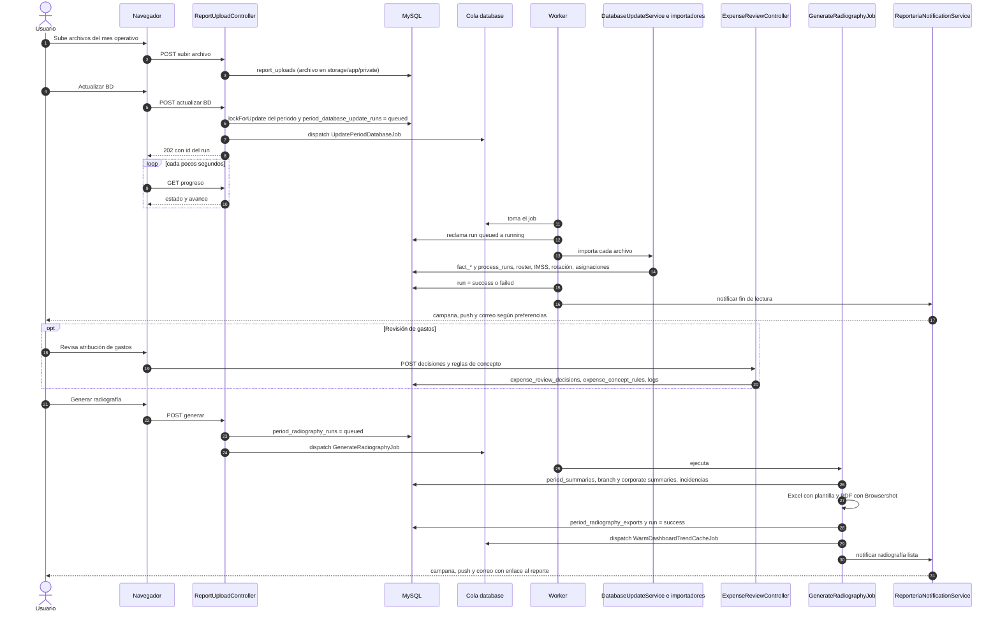

### 7.2 Estado de Resultados

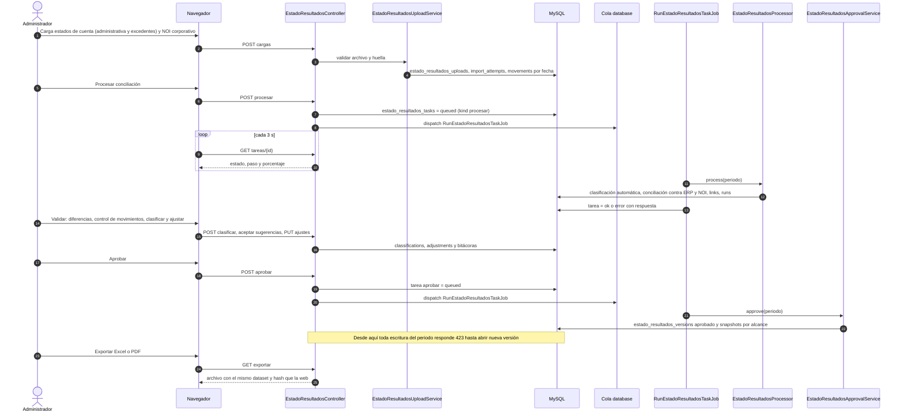

### 7.3 API: mes natural

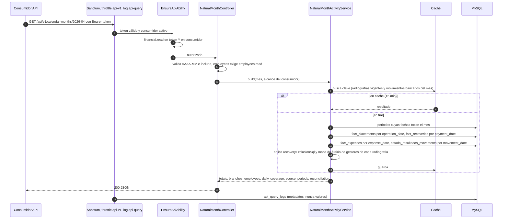

### 7.4 Estados de los procesos

Runs de «Actualizar BD», reproceso y radiografía (`period_database_update_runs`,
`period_reprocess_runs`, `period_radiography_runs`):

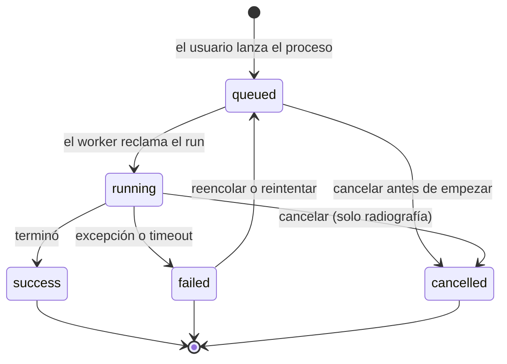

`cancelled` solo existe en `period_radiography_runs`. El job solo cambia de estado con un
`UPDATE ... WHERE status = <esperado>` (comparar y cambiar), así que una re-entrega no pisa un
run vivo.

Tareas del Estado de Resultados (`estado_resultados_tasks`): `queued → running → ok | error`;
una tarea `queued`/`running` de más de 2 h se considera interrumpida.

Ejecuciones de Efectividad V4 heredadas (`efectividad_cobranza_runs`): `queued`, `running`,
`retrying`, `success`, `blocked` (faltan datos, nunca 0 %), `failed`, `cancelled`; en pantalla
también «Retrasado», «Sin actividad del worker» y «Obsoleto».

---

## 8. API v1

Capa REST **de solo lectura**, servidor a servidor (0 rutas que no sean GET/HEAD, verificado por
`ApiFinalSecurityChecklistTest`). La API **no recalcula** nada: todo valor financiero pasa por
`App\Services\Api\FinancialMetricResolver`, que delega en
`RadiografiaExportService::buildSnapshot()` (la misma fuente de web, Excel, PDF y OKR). Sin
radiografía o sin atribución devuelve `value: null` con `status` explícito.

Contrato formal: [`docs/api-openapi.yaml`](api-openapi.yaml). Documentación navegable para
administradores: `/documentacion-api`.

### 8.1 Autenticación y consumidores

Tokens personales de **Sanctum** emitidos a un `App\Models\ApiConsumer` (un **sistema**, nunca
un usuario humano; un token de consumidor nunca autentica en el guard `web`).

```
Authorization: Bearer <token>
```

```bash
# Alta (el token se imprime UNA sola vez; Sanctum guarda solo el hash)
php artisan api:consumers:create "Auditoría Operativa" auditoria-operativa \
  --ability=branches.read --ability=employees.read --ability=financial.read \
  --ability=periods.read --ability=collections.read --ability=okr.read
# Restringido a sucursales (bloquea scope=general)
php artisan api:consumers:create "Auditoría Córdoba" auditoria-cordoba --branch=5 --branch=9
# MR. LANA PEOPLE (Seguimiento), acceso global
php artisan api:consumers:create "MR. LANA PEOPLE" mr-lana-people \
  --ability=branches.read --ability=employees.read --ability=periods.read --ability=financial.read
# Revocar (todos los tokens o uno con --token-id) y desactivar
php artisan api:consumers:revoke auditoria-operativa --deactivate
```

Sin `--ability` el comando concede todas menos `collections.export`. No hay pantalla de
administración de consumidores. El token de PEOPLE va en su `.env` (`REPORTES_API_TOKEN`). Si
un consumidor pierde su token se revoca y se emite otro; no se puede recuperar.

### 8.2 Abilities

| Ability | Recursos |
|---|---|
| `branches.read` | `/branches`, `/sucursales` |
| `branches.read.global` | ver el catálogo **completo** de sucursales aunque el consumidor esté restringido |
| `employees.read` | `/employees`, `/employees/{id}`, `/people` |
| `periods.read` | `/periods`, `/periods/{id}` |
| `financial.read` | `/financial/*`, `/periods/{id}/branches`, `/periods/{id}/weekly-activity`, `/calendar-months*`, `/periods/{id}/export`, `/periods/export` |
| `employees.read` **y** `financial.read` | `/employees/{id}/financial-summary`, `/periods/{id}/employees`, `/employees/{id}/periods`; también el bloque de colaboradores de los exports, de `weekly-activity` y de `calendar-months` |
| `collections.read` | `/collections/effectiveness` |
| `collections.export` | `/collections/effectiveness/export` (propia; leer no basta; no se concede por defecto) |
| `okr.read` | `/okr/*` |

`ensure.ability` (`EnsureApiAbility`) exige **todas** las abilities listadas y verifica que estén
tanto en el **token** (`tokenCan()`) como en `ApiConsumer.abilities`: el consumidor es un techo
real. `/health` es pública; `/capabilities` solo requiere autenticación y dice qué puede hacer
ese token (`implemented`, `permitted`, `blocked_reason` por recurso y bloque `features`).

### 8.3 Alcance por sucursal

`ApiConsumer.branch_access_mode`:

- `global`: sin restricción (`scope=general` o cualquier sucursal/colaborador).
- `restricted`: solo `allowed_branch_ids`. Si el arreglo queda vacío se trata como `none`,
  nunca como global.
- `none`: sin acceso a ninguna sucursal (catálogos vacíos, 403 en lo demás).

Un colaborador se autoriza por su sucursal **exacta en el `period_id` pedido**
(`EmployeeBranchHistoryResolver`), nunca por la asignación más reciente; sin asignación
registrada se niega. OKR autoriza por la sucursal **efectiva del objetivo** (la suya o la del
padre). `ApiScopeResolver` centraliza la verificación.

### 8.4 Límites, auditoría y errores

- `api-v1`: 60 peticiones/min **por consumidor**; `api-exports`: 20/min adicional en exports
  (`AppServiceProvider`).
- Cada petición autenticada queda en `api_query_logs` (endpoint, método, estado, alcance,
  ids, IP, fecha), **nunca** con valores ni payload. Retención `API_QUERY_LOG_RETENTION_DAYS`
  (90), purga diaria 03:00. `last_used_at` se reescribe como máximo cada 60 s.
- Errores JSON `{"message": "..."}`: 401 (sin token o inválido/revocado), 403 (sin ability,
  consumidor inactivo o fuera de alcance), 404 (no existe), 409 (archivo ausente en un export),
  422 (parámetros inválidos: `scope`, `period_id`, `metrics`, `per_page` fuera de 1-100, ids no
  numéricos, validados por `ApiValidation`), 429 (rate limit).
- Parámetros comunes: `scope` = `general` | `branch` | `employee` (default `general`),
  `branch_id`, `employee_id`, `period_id`. `period_id` es **obligatorio** en los endpoints
  financieros: la API nunca adivina «el periodo más reciente».

### 8.5 Endpoints

| Método | Endpoint | Ability |
|---|---|---|
| GET | `/api/v1/health` | — |
| GET | `/api/v1/capabilities` | autenticado |
| GET | `/api/v1/branches` | `branches.read` |
| GET | `/api/v1/sucursales` | `branches.read` |
| GET | `/api/v1/employees`, `/api/v1/employees/{id}` | `employees.read` |
| GET | `/api/v1/people?per_page=&include_placeholders=` | `employees.read` |
| GET | `/api/v1/employees/{id}/financial-summary?period_id=` | `employees.read` + `financial.read` |
| GET | `/api/v1/periods`, `/api/v1/periods/{id}` | `periods.read` |
| GET | `/api/v1/financial/summary?period_id=&scope=` | `financial.read` |
| GET | `/api/v1/financial/branches/{id}?period_id=` | `financial.read` |
| GET | `/api/v1/financial/employees/{id}?period_id=` | `financial.read` |
| GET | `/api/v1/financial/metrics` | `financial.read` |
| GET | `/api/v1/financial/metric-values?period_id=&scope=&metrics=a,b,c` | `financial.read` |
| GET | `/api/v1/periods/{id}/employees?page=&per_page=&branch_id=&sucursal_id=&format=csv` | `employees.read` + `financial.read` |
| GET | `/api/v1/employees/{id}/periods?from_period_id=&to_period_id=` o `period_ids=` | `employees.read` + `financial.read` |
| GET | `/api/v1/periods/{id}/branches?format=csv` | `financial.read` |
| GET | `/api/v1/periods/{id}/export?include=branches,employees` | `financial.read` (+ `employees.read`), `api-exports` |
| GET | `/api/v1/periods/export?from_period_id=&to_period_id=&format=csv&dataset=` | ídem |
| GET | `/api/v1/periods/{id}/weekly-activity?include=branches,employees` | `financial.read` (+ `employees.read`) |
| GET | `/api/v1/calendar-months` | `financial.read` |
| GET | `/api/v1/calendar-months/{AAAA-MM}?include=branches,employees,daily,bank_movements` | `financial.read` (+ `employees.read`) |
| GET | `/api/v1/collections/effectiveness?period_id=&scope=` | `collections.read` |
| GET | `/api/v1/collections/effectiveness/export?period_id=&scope=` | `collections.export`, `api-exports` |
| GET | `/api/v1/okr/summary`, `/api/v1/okr/employees/{id}` | `okr.read` |

### 8.6 Métricas (`/financial/metrics`)

| Código | Etiqueta | Unidad | Alcances | Fuente en el snapshot |
|---|---|---|---|---|
| `ebitda` | EBITDA | MXN | general, branch, employee | `summary.ebitda_final` |
| `ebitda_margin` | Margen EBITDA | % | todos | `summary.margen_ebitda` |
| `opex` | OPEX | MXN | todos | `summary.opex_total` |
| `placement` | Colocación | MXN | todos | `summary.placement_total` |
| `recovery` | Recuperación | MXN | todos | `summary.recovery_total` |
| `mora` | Mora | % | todos | `summary.mora_index` |
| `portfolio_total` | Cartera total | MXN | todos | `summary.portfolio_total` |
| `portfolio_overdue` | Cartera vencida | MXN | todos | `summary.overdue_portfolio` |
| `portfolio_current` | Cartera vigente | MXN | todos | derivado: total − vencida (null si sale negativo) |
| `turnover` | Rotación | % | general, branch | `sections.rotation` |
| `collections_effectiveness_legacy` | Efectividad histórica | % | todos | `sections.efectividad_cobranza` |

Forma de cada valor:

```json
{
  "metric": "ebitda", "period_id": 42, "period_type": "monthly", "period_label": "Abril 2026",
  "start_date": "2026-03-30", "end_date": "2026-04-26", "calculated_at": "11/10/2026 01:30",
  "source": "reporteria.radiography_snapshot", "status": "ok",
  "scope": { "type": "branch", "branch_id": 5, "employee_id": null },
  "value": 123456.78, "unit": "MXN", "definition_version": "v1"
}
```

`status` ∈ `ok` | `not_available` (sin radiografía) | `not_attributable` (no aplica al alcance).

### 8.7 Atribución a sucursal y periodos

- Un `branch` es una **ruta/oficina operativa**; las **11 sucursales** institucionales están en
  `sucursales` y se ligan con `branches.sucursal_id` (`SucursalSeeder`, catálogo
  `BranchRouteCatalog`, nunca por parecido). Branches sin sucursal (San Juan del Río, Tenango
  del Valle, Aguascalientes, Corporativo, agrupaciones) → `sucursal: null`. **Si no se corre
  `SucursalSeeder`, `sucursal` sale `null` en toda la API.**
- Campos aditivos: `/branches` → `sucursal {id,codigo,nombre}`, `region`, `active`
  (`Branch::derivedActive()`); `/employees` → `branch`, `sucursal`, `region`;
  `financial-summary` → `sucursal_id`, `sucursal_status` (`known`/`unknown`), histórico del
  periodo.
- `/periods` y `/periods/{id}` exponen `component_period_ids`, `custom_name` y `system_label`;
  `label` usa el nombre manual.
- `employee_code` (clave NOI) **no es único**: un consumidor nunca debe vincular personas solo
  por código. La correspondencia con PEOPLE vive en PEOPLE (tabla de mapeo confirmada por una
  persona). `employee_external_identities` existe pero no se puebla.

### 8.8 Exportación de KPIs por periodo

| Endpoint | Qué devuelve | Paginación / formato |
|---|---|---|
| `/periods/{id}/employees` | Colaboradores del periodo con sucursal, rutas, estado laboral y KPIs | `page`, `per_page` 1-100; filtros `branch_id`, `sucursal_id`; `format=csv` (todas las filas) |
| `/employees/{id}/periods` | Un colaborador en varios periodos (incluye efectividad) | rango máx. 24; `include_effectiveness=0`; `format=csv` |
| `/periods/{id}/branches` | Sucursales + `corporate` + `consolidated` + `reconciliation` | `format=csv` |
| `/periods/{id}/export` | Todo lo anterior en una llamada | `include=branches,employees` |
| `/periods/export` | Igual para un rango (máx. 12) | `format=csv&dataset=employees|branches` |

Rango: `period_ids=19,20,21` o `from_period_id`/`to_period_id` (periodos del mismo tipo). Sin
parámetros → 422. CSV en UTF-8 con BOM, columnas con la ruta del campo
(`kpis.ebitda.ebitda`), listas anidadas como JSON.

Fuentes (paridad con el reporte):

| Bloque | Fuente |
|---|---|
| Colaboradores | `RadiographySnapshotBuilder::buildAllEmployeeGestorRows()` + OPEX de `OpexClassificationService` + EBITDA de `computeEmployeeFinancialMetrics()` (= Excel de colaboradores). Servicio `EmployeePeriodKpiService`. |
| Sucursales | `snapshot.branch_radiography.branches` con `nominaTotalFor()`, `gastosTotalesFor()`, `ingresoEbitdaBaseFor()`, `ebitdaFinalFor()`, `margenEbitdaFor()`. Servicio `PeriodBranchKpiService`. |
| Corporativo | `branch_radiography.unassigned` (hoja SIN ASIGNAR) + `sections.corporate_funding`. Coloca, cobra y cartera son `not_attributable`. `ebitda_contribution` = −nómina corporativa. |
| Consolidado | `snapshot.summary` + `branch_radiography.global`. |
| `reconciliation` | `ebitda.difference` debe ser 0. `portfolio.difference` puede no serlo (el consolidado incluye todas las rutas salvo Aguascalientes). |

KPIs de la fila de colaborador: `placement` (monto, operaciones, por producto), `recovery`
(total y componentes con las mismas exclusiones del reporte), `portfolio` (total, vencida,
vigente, mora %, buckets), `payroll` (`human_capital_total` = neto que entra al EBITDA,
conceptos NOI, deducciones informativas), `commissions` (P002/P119), `opex` (automático
atribuido; `manual` siempre 0 porque el ajuste manual es efímero), `ebitda` (base de ingreso −
gastos, margen, categoría). `collections_effectiveness` es `null` en el listado (cálculo
pesado): está en `/employees/{id}/periods`. Filas sin identidad (`unidentified`) solo para
consumidores globales. Verificado contra la BD real (Junio 2026, periodo 21): 136
colaboradores, 0 diferencias contra el Excel de colaboradores.

Fila de ejemplo (valores ilustrativos, recortada):

```json
{
  "employee": { "id": 412, "employee_ids": [412, 977], "full_name": "NOMBRE APELLIDO", "employee_code": "0153", "promoter_code": "P-118", "is_active": true },
  "branch_id": 131, "branch": { "id": 131, "code": "TULACEN", "name": "TULA CENTRO" }, "branch_status": "known",
  "sucursal": { "id": 11, "codigo": "tula", "nombre": "TULA" }, "region": "Q3",
  "routes": [{ "route": "TULA CENTRO", "sources": ["assignment", "portfolio"], "contracts": 214, "balance": 812345.10 }],
  "employment": { "operational_status": "ACTIVO", "roster_status": "activo_confirmado", "is_active_for_period": true },
  "kpis": {
    "placement": { "amount": 210000.00, "operations": 21 },
    "recovery": { "total": 265000.00 },
    "portfolio": { "total": 812345.10, "overdue": 96000.00, "current": 716345.10, "mora_pct": 11.82 },
    "payroll": { "human_capital_total": 14250.00 },
    "opex": { "automatic_total": 1350.00, "manual": 0, "total": 1350.00 },
    "ebitda": { "income_base": 63980.00, "total_expenses": 15600.00, "ebitda": 48380.00, "margin_pct": 75.62, "category": "JUNIOR" },
    "collections_effectiveness": null
  }
}
```

Envolvente: `{ period, status, message, source, definition_version, calculated_at,
radiography_version, data: [...], meta: { current_page, per_page, total, last_page,
unidentified_count } }`. Caché: 12 h por periodo + versión de la radiografía (regenerar la
invalida). Sin radiografía → `status: not_available`, `data: []`.

Alcance: un consumidor restringido solo recibe colaboradores cuya **asignación del periodo**
está permitida; `/employees/{id}/periods` marca `forbidden` los periodos fuera de alcance;
`corporate`/`consolidated` → `{status: not_authorized}` y `reconciliation: null`.

### 8.9 Actividad semanal de un mes (`/periods/{id}/weekly-activity`)

Para PEOPLE («Seguimiento»). Solo periodos `monthly` con semanas (si no, 422). Reparte por
semana colocación (`fact_placements.operation_date`) y recuperación
(`fact_recoveries.payment_date`, regla `recoveryExclusionSql()`), con el mismo mapa de fusión
de gestores de la radiografía (`lastGestorMergeMap()`): Σ semanas + `outside_weeks` = cifra
oficial del mes (`month_official`). Movimientos sin fecha o fuera de las semanas van a
`outside_weeks`. Sucursal por `branch_id` del movimiento (`attribution: fact_branch_id`); los
KPIs oficiales por sucursal siguen en `/periods/{id}/branches`. Cartera, mora, nómina, OPEX y
EBITDA no tienen versión semanal. `unassigned`, `unidentified` y `reconciliation` solo para
consumidores globales. Caché 12 h (~7 s en frío, ~0.2 s en caliente).

### 8.10 Directorio de personas y sucursales

- `GET /people` (`PeopleDirectoryService`): **una fila por persona** (no por registro). Reglas
  de identidad del reporte: nombre normalizado, variantes de captura (Levenshtein ≤ 2), rechazos
  de fusión respetados. Campos: `id` (registro principal), `employee_ids`, `full_name`,
  `name_variants`, `employee_codes`, `kind` (`person`/`placeholder` + motivo),
  `current_branch_id`, `sucursal`, `routes[]`. `per_page` 1-500 (100), caché 6 h que se
  invalida con cada import.
- `GET /sucursales`: sucursales oficiales con sus rutas (catálogo ruta → sucursal; si no, por
  `branches.sucursal_id`; si tampoco, en el elemento `code: null`).

### 8.11 Meses naturales (`/calendar-months`)

`GET /calendar-months` lista los meses con al menos un día cubierto (`month`, `date_from`,
`date_to`, `days`, `covered_days`, `status` `complete`/`partial`).
`GET /calendar-months/{AAAA-MM}` (mes inválido → 422):

| Bloque | Fecha que decide | Regla |
|---|---|---|
| `totals.placement` | `fact_placements.operation_date` | `SUM(amount)` / `COUNT(*)` |
| `totals.recovery` | `fact_recoveries.payment_date` | regla única del reporte |
| `totals.erp_expenses` | `fact_expenses.expense_date` | monto ERP registrado (no aplica reglas de OPEX) |
| `bank_movements` | `estado_resultados_movements.movement_date` | cargos/abonos de cargas vigentes, sin duplicados, por tratamiento y sucursal |
| `employees` | las de colocación y recuperación | mismo motor que 8.9; `by_period` = aporte de cada periodo |

Además: `coverage` (`missing_ranges`, `periods_without_data`), `source_periods[]` (traslape y
aporte de cada periodo), `audit.outside_own_period_window`, `reconciliation` (Σ sucursales = Σ
días = Σ colaboradores = total) y `employees.missing_periods`. **No es un Estado de Resultados
mensual** (el ER es por periodo de 4 semanas y por devengo; aquí son datos por fecha). Caché 15
min. Verificado con abril, mayo y junio 2026: cuadran al centavo.

```bash
curl -H "Authorization: Bearer $TOKEN" https://<host>/api/v1/calendar-months
curl -H "Authorization: Bearer $TOKEN" "https://<host>/api/v1/calendar-months/2026-04?include=branches,daily"
```

### 8.12 Efectividad de cobranza en la API

`GET /collections/effectiveness` devuelve **dos versiones** sin mezclarlas:

- `versions.legacy`: la efectividad histórica de la radiografía (vigente/atrasado/vencido +
  `efectividad_pct`).
- `versions.approved`: lee, sin recalcular, la última ejecución **V4 SEMANAL** exitosa del
  periodo semanal y alcance exactos (`approved_snapshot_v4`, motor `mrlana-v4-2026-10`,
  metodología `V7`). Estados `ok`, `stale` (cambiaron fotos o ingresos), `not_available`
  (incluye runs con metodología anterior: pide regenerar), `not_attributable` (por colaborador
  exige asignación verificada y **una sola** fila con su nombre) y `not_supported_period`.

Cuatro versiones distintas viajan en la respuesta: `api_version` (`v1`), `definition_version`
(catálogo de métricas), `engine_version` (motor) y `methodology` (regla financiera).

`GET /collections/effectiveness/export` descarga el Excel V4 ya generado (disco privado):
`scope` `general` o `branch`, periodo semanal; 404 sin ejecución vigente, 409 si falta el
archivo, 422 con `scope=employee` o periodo no semanal.

> Nota: la calculadora vigente en la web es V12.9.4 y **no guarda** ejecuciones, por lo que la
> versión `approved` de la API solo refleja ejecuciones V4 históricas. Ver pendientes.

### 8.13 Guía para consumidores

1. `GET /periods?type=monthly` para resolver el `period_id` (los ids no son correlativos con
   los meses).
2. `GET /branches`, `/sucursales`, `/people` como catálogos (cachear; cambian poco).
3. Revisar siempre `status` antes de usar `value`: `not_available`/`not_attributable` significan
   «no hay dato», nunca cero.
4. No replicar `fact_*`; no dividir el total de una sucursal para inferir un individuo; no tratar
   la efectividad legacy como la aprobada.
5. HTTPS obligatorio (el token viaja en la cabecera).
6. Prueba local (WAMP): `http://localhost/Reportes/public/api/v1/health` responde 200.

---

## 9. Colas, jobs y scheduler

Conexión `database`, cola `default`, **un** worker (`numprocs=1`, los jobs corren uno tras
otro). Ningún job fija `$queue` (el precalentado de comparativas usa
`config('estado_resultados.cache.precalentar_cola')`, `default`).

| Job | Lo lanza | `$timeout` / `$tries` |
|---|---|---|
| `UpdatePeriodDatabaseJob` | «Actualizar BD» / «Cargar registros» | 1800 s / 1 |
| `GenerateRadiographyJob` | Generar radiografía (simple o comparativo, general/sucursal/gestor) | 1800 s / 3 (maxExceptions 1) |
| `ReprocessPeriodUploadsJob` | Reprocesar todas las fuentes de un periodo (+ correo) | **3600 s** / 1 |
| `ReprocessReportUploadJob` | Reprocesar un archivo (+ correo) | 1800 s / 1 |
| `RunEstadoResultadosTaskJob` | ER: «Procesar conciliación» y «Aprobar» | 1800 s / 1 (failOnTimeout) |
| `WarmDashboardTrendCacheJob` | Al terminar una radiografía | 300 s / 1 |
| `WarmEstadoResultadosComparativesJob` | Precalentado de comparativas del ER (`ShouldBeUnique`) | 600 s / 1 |
| Notificaciones `Reporteria/*` y correos `Reprocess*Mail` | `ShouldQueue` / `Mail::queue()` | — |
| `GenerateEfectividadCobranzaAprobadaJob`, `GenerateEfectividadAprobadaPeriodicaJob`, `ImportPortfolioSnapshotJob`, `ImportNoiNominaJob` | **Ninguna ruta los lanza hoy** (código heredado) | — |

Ya **no** usan cola: la calculadora de Efectividad, los PDF de OKR (Browsershot en la petición),
las invitaciones de usuario (`send()` síncrono) y los exportes Excel/PDF (descarga en la misma
respuesta, `memory_limit` 1 GB).

**Regla de tiempos**: el `$timeout` del job manda sobre `--timeout`. `DB_QUEUE_RETRY_AFTER`
(3700) y `stopwaitsecs` (3700) deben ser **mayores que 3600**; si no, la cola re-entrega un job
vivo y lo duplica. Tras cada despliegue: `php artisan queue:restart`.

Scheduler (`routes/console.php`, zona `America/Mexico_City` fija en `config/app.php`):

| Hora | Comando | Notas |
|---|---|---|
| 03:00 | `api:query-logs:prune` | Retención de `api_query_logs`. |
| 03:10 | `reportes:purgar-cache-vencida` | Solo filas vencidas de `cache`/`cache_locks`, por lotes; con Redis no hace nada. |
| 03:20 | `queue:prune-failed --hours=720` | Conserva 30 días. |
| 03:25 | `queue:prune-batches --hours=168 --unfinished=168 --cancelled=168` | |
| 05:30 | `er:precalentar-comparativas --ultimos=3` | `withoutOverlapping`. |
| 06:00 | `okr:refresh` | Idempotente. |
| 06:15 | `okr:close-due` | Idempotente. |
| cada 10 min | `efectividad:limpiar-temporales` | Espacios cifrados de más de 60 min y exportes interrumpidos. |
| cada 30 min (`RADIOGRAFIA_PRECALENTAR_CRON`) | `radiografia:precalentar` | `withoutOverlapping(30)`, `onOneServer`, `runInBackground`. |

**Precalentado de la radiografía**: la API (`financial-summary`, `/periods/{id}/branches`), el
Dashboard, el comparativo y OKR proyectan la corrida **general** del mes
(`generalStateCached()`, 10-25 s en frío). El cálculo en frío usa `Cache::lock` por clave (los
demás esperan hasta 45 s). El comando mantiene en caché los 3 meses más recientes con
radiografía vigente y refresca los que tengan más de 6 h. **No subir el TTL a días**: el cálculo
lee `fact_*` en vivo y la clave solo cambia al regenerar/invalidar la radiografía. Comprobar:

```bash
php artisan schedule:list | grep radiografia
php artisan radiografia:precalentar          # caliente / calculado / refrescado · ms por periodo
grep "radiografia:precalentar" storage/logs/laravel*.log | tail -5
```

Diagnóstico de la cola: `php artisan reportes:debug-queue-health`.

---

## 10. Notificaciones

| Evento | Destinatarios | Campana | Push | Correo |
|---|---|---|---|---|
| Termina la lectura de archivos (`UpdatePeriodDatabaseJob`): éxito, fuentes pendientes o error | quien lanzó | siempre | si lo tiene activo | `DatabaseUpdateCompletedMail` / `DatabaseUpdateFailedMail` |
| Termina la radiografía (`GenerateRadiographyJob`) | quien lanzó | siempre | si activo | `ReportGeneratedMail` / `ReportGenerationFailedMail` |
| Nuevo mes operativo (no al regenerar uno existente) | quien lo creó y usuarios activos con módulo Carga o Periodos | siempre | si activo | `MonthlyPeriodCreated` |
| Reprocesos | quien lanzó | — | — | `Reprocess*Mail` (en cola) |
| Alta de usuario / restablecer | el usuario | — | — | `UserAccessGrantedMail` (síncrono) |

- Piezas: `app/Notifications/Reporteria/*` (base `ReporteriaProcessNotification`,
  `PeriodDatabaseUpdateFinished`, `RadiographyGenerationFinished`, `MonthlyPeriodCreated`,
  `PushTestNotification`), `app/Services/Notifications/ReporteriaNotificationService.php`,
  `config/webpush.php` (modelo `App\Models\PushSubscription`), tablas `notifications`,
  `push_subscriptions` (índice único sobre `endpoint_hash` SHA-256) y
  `user_notification_preferences` (sin fila = todo activo).
- Rutas: `/notificaciones` (campana: listar, marcar leídas) y `settings/notificaciones`
  (GET/PATCH preferencias, POST/DELETE suscripción, POST prueba).
- Frontend: `composables/usePushNotifications.ts`, `components/settings/PushNotificationToggle.vue`,
  `NotificationPreferencesTable.vue`, `pages/settings/Notifications.vue`,
  `BackgroundActivityBell.vue`. `public/sw.js` maneja `push` y `notificationclick` (abre la
  pantalla del aviso).
- Garantías: todo va **en cola** (necesita el worker); un aviso que falla **nunca** rompe el job
  (`ReporteriaNotificationService` atrapa y deja `warning` con «Notificaciones:»); sin VAPID el
  canal push se omite; una suscripción expirada se borra sola; máximo 10 dispositivos por
  usuario. Sin servicios de pago: el push viaja por el servicio del navegador firmado con VAPID.
- Requisitos: **HTTPS**; extensiones `openssl`, `curl`, `mbstring` y `gmp` (o `bcmath`, más
  lento). iPhone/iPad solo reciben push con la app instalada en la pantalla de inicio (iOS
  16.4+). Las notificaciones se activan **por dispositivo**.

---

## 11. Seguridad, permisos y roles

### 11.1 Capas de autorización web

1. **Autenticación**: Fortify (login, 2FA, recuperar contraseña; **registro público
   deshabilitado**) con `verified` obligatorio. `EnsureUserNotDisabled` cierra la sesión si
   `disabled_at` tiene valor. El listener `RecordUserLastLogin` guarda `last_login_at`.
2. **Rol** (`users.role`): `admin`, `gerencial`, `colaborador` o la clave de un rol
   personalizado de la tabla `roles` (hereda `base_level` gerencial o colaborador;
   `RoleCatalogService`, caché `roles_catalog.v1`). El admin pasa todo.
3. **Módulo** (`module:<modulo>`, `EnsureModuleAccess`, tabla `role_module_access`): `dashboard`,
   `carga`, `periodos`, `colaboradores`, `reportes`, `efectividad`, `estado_resultados`, `okr`,
   `usuarios`, `roles`. Por defecto gerencial = dashboard, carga, periodos, colaboradores,
   reportes, efectividad, okr; colaborador = okr; `estado_resultados`, `usuarios` y `roles` solo
   admin hasta asignarlos. `GENERAL_SCOPE_MODULES` (`carga`, `periodos`, `estado_resultados`) se
   retiran a usuarios con alcance restringido.
4. **Acción** (`permission:<modulo>,<accion>`, `EnsureActionPermission`, tabla
   `role_action_permissions`, `ActionPermissionService::ACTIONS`):

| Módulo | Acciones |
|---|---|
| carga | subir, generar, procesar, eliminar, descargar |
| periodos | crear, eliminar, cerrar |
| colaboradores | editar, exportar, conciliar |
| reportes | ver_propios, ver_todos, editar, exportar (las tres últimas implican ver_propios) |
| efectividad | calcular, exportar, exportar_excel |
| estado_resultados | ver_nomina, ver_dg, cargar, procesar, clasificar, ajustes, catalogo, aprobar, exportar |
| okr | crear, cargar_colocacion, cargar_evidencia, registrar_seguimiento, configurar_kr, editar_borradores, administrar_otros, anular_documentos, exportar, activar, revisar_carta, emitir_carta, generar_warning, autorizar_warning |
| usuarios | crear, invitar, editar, asignar_rol, gestionar_acceso, restablecer |
| roles | crear, editar, eliminar |

   Sin valor por defecto para ningún rol: `colaboradores.conciliar`, `efectividad.exportar_excel`,
   todo `estado_resultados`, `usuarios`, `roles` y `okr.administrar_otros`.
5. **Delegación**: `AccessDelegationGuard` impide que un no-admin otorgue más de lo que tiene o
   asigne el rol Administrador.
6. **Alcance de datos**: `DataScopeService` + `user_branch_scopes` (`branch_scope` `all` o
   restringido); `EnsureBranchScope` responde 403 si `branch_id`/`manual_branch_id` están
   fuera. `ReportVisibilityService` limita reportes por autor (`ver_propios`).
7. **OKR**: `EnsureOkrAccessEnabled` (`access_enabled_at`), `OkrObjectivePolicy` y Gates
   (`okr.view`, `okr.history.view`, `okr.create` gerencial/admin, `okr.kpi.manage` y
   `okr.admin` solo admin). Visibilidad de objetivos individuales por `users.employee_id`
   (`OkrObjectiveVisibilityService`).

Los permisos por defecto los siembran migraciones (`insertOrIgnore`), no seeders. Las matrices
se cachean (`role_module_access.v1`, `role_action_permissions.v1`).

### 11.2 Archivos y datos

- Originales de usuario, exportes, documentos y evidencias OKR, archivos del ER y temporales de
  Efectividad (cifrados) viven en el **disco privado** `local` (`storage/app/private`). Nada
  escribe ya en el disco `public`; solo se lee como respaldo de archivos no migrados.
- **No ejecutar `storage:link`** (ninguna vista usa URLs `/storage`) y bloquear `/storage/` en
  Nginx. El disco `local` tiene `serve => true` pero solo entrega con URL firmada, y la app no
  genera ninguna.
- CSRF sin excepciones; `#[Fillable]/#[Hidden]` en `User`; Browsershot solo recibe HTML
  escapado; errores sin traza con `APP_DEBUG=false`; credenciales masivas cifradas y
  descargables una sola vez; el CSV de incidencias de Efectividad neutraliza textos que empiezan
  con `= + - @`.
- El código no registra contraseñas ni tokens, pero algunos `Log::warning` escriben **nombres
  completos** de colaboradores (`RadiographySnapshotBuilder`): `storage/logs` es dato personal
  (permisos 0660, sin acceso web).
- No se encontraron secretos en el repositorio ni en su historial. Si un `.env` real se
  filtrara: cambiar `APP_KEY` (cierra sesiones e invalida lo cifrado), contraseñas de BD y SMTP
  y reemitir tokens de API.

### 11.3 Datos reales en el historial de git (pendiente con autorización)

El repositorio (`JesusA2004/Reportes` → `mrlanasistemas-star/Reportes`) **fue público** y su
historial contiene nóminas, clientes, gastos, IMSS, libros de Efectividad, salidas de auditoría
(`storage/audit*`), estados de cuenta (`docs/3EBITDA/*`) y el directorio de gerencias. Ya no
están en `main` (se retiraron y se ignoran), pero siguen en el historial. Procedimiento
pendiente de autorización del dueño:

```bash
# 1) Hacer el repositorio privado (GitHub → Settings → Danger Zone)
# 2) En un clon espejo NUEVO, nunca en la copia de trabajo
git clone --mirror https://github.com/mrlanasistemas-star/Reportes.git reportes-limpieza.git
cd reportes-limpieza.git
git filter-repo --invert-paths \
  --path documentosEjemplo/ --path documentosJunio/ --path documentosMayo/ \
  --path documentosColumnas/ --path docRadios/ --path storage/audit/ --path storage/audit_before/ \
  --path docs/3EBITDA/ --path docs/usuarios/DIRECTORIO_GERENCIAS_MRLANA.xlsx \
  --path "docs/efectividad/MR_LANA_EFECTIVIDAD PRUEBA TULA.xlsm" \
  --path "docs/efectividad/MR_LANA_EFECTIVIDAD.xlsm" \
  --path "docs/efectividad/CALCULADORA DE EFECTIVIDAD DE COBRANZA APROBADO.xlsm"
git log --all --no-renames --diff-filter=A --name-only --format= \
  | grep -E '^(documentos|docRadios|storage/audit|docs/3EBITDA|docs/usuarios)|\.xlsm$' && echo "AUN HAY DATOS" || echo "limpio"
git remote add origin https://github.com/mrlanasistemas-star/Reportes.git
git push --force origin 'refs/heads/*:refs/heads/*' 'refs/tags/*:refs/tags/*'   # no usar --mirror
```

Después: pedir a GitHub Support la purga de caché; todos los clones (equipos, VPS, worktrees)
deben **borrarse y volver a clonarse**; asumir que los datos ya se filtraron y evaluar avisos
según la LFPDPPP. Unos 60 archivos de `app/` y `tests/` contienen nombres reales en reglas de
excepción o datos de prueba: conviene pasarlos a datos de BD/configuración y nombres
ficticios. Prevención: revisar `git status` antes de `git add`; activar *Secret scanning* y
*Push protection*.

---

## 12. Despliegue en el VPS

Rutas de ejemplo: proyecto en `/var/www/reportes`, usuario de servicio `www-data`, dominio
`reportes.mr-lana.com`, PHP 8.4 FPM, Supervisor con programa `reportes-worker`. Ajústalas.

Orden obligatorio en una instalación nueva: paquetes → clon → Composer → `.env` → build →
**BD + `migrate --seed`** → administrador → permisos de storage → caches → Nginx/SSL →
workers → cron → validación. Nginx no debe publicar el sitio antes de migrar la base.

### 12.1 Paquetes

```bash
sudo apt install nginx mysql-server supervisor git unzip \
  php8.4-fpm php8.4-cli php8.4-common php8.4-mysql php8.4-mbstring php8.4-xml php8.4-zip \
  php8.4-gd php8.4-curl php8.4-intl php8.4-bcmath php8.4-gmp
# Opcional: redis-server php8.4-redis (sección 12.11)
# Node.js 24 LTS (NodeSource o nvm) y Composer 2 según su guía oficial.
# Librerías de Chrome headless:
sudo apt install libnss3 libatk1.0-0 libatk-bridge2.0-0 libcups2 libxkbcommon0 libxcomposite1 \
  libxdamage1 libxrandr2 libgbm1 libpango-1.0-0 libasound2 fonts-liberation
```

Comprobar extensiones en **CLI y FPM** (`calendar`, `ctype`, `fileinfo`, `iconv`, `tokenizer`
vienen en `php8.4-common`; `pcntl` en `php8.4-cli`):

```bash
for e in calendar ctype curl dom fileinfo filter gd gmp iconv intl libxml mbstring openssl pcntl \
         pdo_mysql session simplexml tokenizer xml xmlreader xmlwriter zip zlib; do
  php -m | grep -qix "$e" || echo "FALTA (CLI): $e"; done
```

PHP 8.5 **no sirve** (PhpSpreadsheet exige `<8.5.0`). Uso de extensiones: `calendar`
(Efectividad), `zip`/`xml*`/`dom`/`simplexml`/`gd`/`iconv`/`zlib` (PhpSpreadsheet, OpenSpout,
exportación PNG, pdfparser), `fileinfo` (Flysystem, Browsershot), `pcntl` (timeout real de los
jobs), `gmp`/`bcmath` (Web Push).

### 12.2 Código, dependencias y `.env`

```bash
sudo mkdir -p /var/www && cd /var/www
sudo git clone <url-del-repositorio> reportes        # repo privado + deploy key de solo lectura
sudo chown -R www-data:www-data /var/www/reportes && cd /var/www/reportes
sudo -u www-data composer install --no-dev --optimize-autoloader --no-interaction
sudo -u www-data cp .env.example .env && sudo -u www-data php artisan key:generate
# editar .env (abajo) y después:
sudo -u www-data npm ci
sudo -u www-data npm run build    # el plugin Wayfinder arranca Laravel: PHP en PATH y .env completo
```

No borres `node_modules` ni uses `npm ci --omit=dev`: `puppeteer` es dependencia de ejecución.

```dotenv
APP_NAME="Reportes MR LANA"
APP_ENV=production
APP_DEBUG=false
APP_URL=https://reportes.mr-lana.com

DB_CONNECTION=mysql
DB_HOST=127.0.0.1
DB_PORT=3306
DB_DATABASE=reportes
DB_USERNAME=reportes
DB_PASSWORD=********
DB_ENGINE=InnoDB

SESSION_DRIVER=database
SESSION_ENCRYPT=true
SESSION_SECURE_COOKIE=true
CACHE_STORE=database             # o redis (12.11)
QUEUE_CONNECTION=database
DB_QUEUE_RETRY_AFTER=3700

LOG_CHANNEL=stack
LOG_STACK=daily
LOG_DAILY_DAYS=14
LOG_LEVEL=warning

MAIL_MAILER=smtp                 # nunca log
MAIL_SCHEME=null                 # null/smtp = STARTTLS 587; smtps = TLS 465
MAIL_HOST=smtp.proveedor.mx
MAIL_PORT=587
MAIL_USERNAME=********
MAIL_PASSWORD=********
MAIL_FROM_ADDRESS="reportes@mr-lana.com"
MAIL_FROM_NAME="${APP_NAME}"

VAPID_SUBJECT="mailto:soporte@mr-lana.com"
VAPID_PUBLIC_KEY=...             # php artisan webpush:vapid --show (una sola vez)
VAPID_PRIVATE_KEY=...

BROWSERSHOT_NODE_BINARY=/usr/bin/node
BROWSERSHOT_NPM_BINARY=/usr/bin/npm
BROWSERSHOT_CHROME_PATH=/var/www/.cache/puppeteer/chrome/linux-XXX/chrome-linux64/chrome
BROWSERSHOT_TIMEOUT=180
BROWSERSHOT_NO_SANDBOX=true
BROWSERSHOT_PDF_READY_TIMEOUT=20000
```

`MAIL_ENCRYPTION` no existe en Laravel 13. Las variables `EFECTIVIDAD_*` son del generador V4
heredado y no afectan nada.

### 12.3 Base de datos

En `/etc/mysql/mysql.conf.d/mysqld.cnf`: `[mysqld]` → `default_storage_engine=InnoDB`.

```sql
CREATE DATABASE reportes CHARACTER SET utf8mb4 COLLATE utf8mb4_unicode_ci;
CREATE USER 'reportes'@'localhost' IDENTIFIED BY '********';
GRANT ALL PRIVILEGES ON reportes.* TO 'reportes'@'localhost';
```

```bash
sudo -u www-data php artisan migrate --seed --force
# DataSourceSeeder, BranchSeeder, SucursalSeeder, OkrKpiSeeder. Roles y permisos por defecto: migraciones.
mysql -e "SELECT ENGINE, COUNT(*) FROM information_schema.TABLES WHERE TABLE_SCHEMA='reportes' GROUP BY ENGINE;"
```

Si la base ya existía antes de `SucursalSeeder`, córrelo una vez:
`php artisan db:seed --class=SucursalSeeder --force` (idempotente).

### 12.4 Administrador inicial

```bash
sudo -u www-data php artisan tinker --execute="
\$u = new App\Models\User;
\$u->forceFill([
  'name' => 'Administrador', 'email' => 'admin@mr-lana.com',
  'password' => Illuminate\Support\Facades\Hash::make(Illuminate\Support\Str::random(40)),
  'role' => 'admin', 'branch_scope' => 'all',
  'email_verified_at' => now(), 'access_enabled_at' => now(),
])->save();"
```

Luego fija la contraseña con «¿Olvidaste tu contraseña?» (requiere SMTP). Sin SMTP, usa una clave
temporal (línea que empiece con espacio para no quedar en el historial) y cámbiala en
Configuración → Seguridad.

### 12.5 Almacenamiento

```bash
# NO ejecutes php artisan storage:link
sudo chown -R www-data:www-data storage bootstrap/cache
sudo find storage bootstrap/cache -type d -exec chmod 2770 {} \;
sudo find storage bootstrap/cache -type f -exec chmod 0660 {} \;
sudo chmod 640 .env && sudo chown www-data:www-data .env
```

| Ubicación | Qué guarda | Cómo se entrega |
|---|---|---|
| `storage/app/private/reports/` | originales cargados (NOI, Lendus, ERP, cartera) | `ReportUploadController::download` (`carga,descargar` + alcance) |
| `storage/app/private/` (resto) | PDF y evidencias OKR, colocación OKR, archivos del ER, Excel de Efectividad V4 | controladores con permiso |
| `storage/app/private/efectividad-tmp/` | calculadora: contenido cifrado, TTL 60 min | se purga sola |
| `storage/app/radiografias/`, `storage/app/audits/`, `storage/app/auditorias/` | exportes de radiografía/Dashboard, auditorías y CSV de comandos | rutas con `reportes,exportar` |
| `storage/app/public/` | solo archivos heredados aún no migrados | nunca por URL |
| `storage/logs/` | log de Laravel y del worker | nunca por web |

### 12.6 Nginx, PHP-FPM y SSL

```nginx
server {
    listen 80;
    server_name reportes.mr-lana.com;
    return 301 https://$host$request_uri;
}

server {
    listen 443 ssl http2;
    server_name reportes.mr-lana.com;
    root /var/www/reportes/public;
    index index.php;

    ssl_certificate     /etc/letsencrypt/live/reportes.mr-lana.com/fullchain.pem;
    ssl_certificate_key /etc/letsencrypt/live/reportes.mr-lana.com/privkey.pem;

    client_max_body_size 140M;          # cargas de hasta 128 MB
    server_tokens off;
    charset utf-8;

    add_header X-Frame-Options "SAMEORIGIN" always;
    add_header X-Content-Type-Options "nosniff" always;
    add_header Referrer-Policy "strict-origin-when-cross-origin" always;
    add_header Strict-Transport-Security "max-age=31536000" always;

    location ^~ /storage/ { return 404; }                 # originales: nunca por URL
    location ~ /\.(?!well-known) { return 404; }           # .env, .git, .htaccess
    location ~ ^/(bootstrap|database|documentos[^/]*|docRadios|docs|tests)/ { return 404; }
    # No bloquear por extensión .xlsx/.pdf: las exportaciones de Laravel terminan así.
    # No bloquear /vendor/: public/vendor/chartjs es legítimo.

    location / { try_files $uri $uri/ /index.php?$query_string; }
    location = /favicon.ico { access_log off; log_not_found off; }
    location = /robots.txt  { access_log off; log_not_found off; }
    error_page 404 /index.php;

    location ~ ^/index\.php(/|$) {
        fastcgi_pass unix:/run/php/php8.4-fpm.sock;
        fastcgi_split_path_info ^(.+\.php)(/.*)$;
        include fastcgi_params;
        fastcgi_param SCRIPT_FILENAME $realpath_root$fastcgi_script_name;
        fastcgi_param DOCUMENT_ROOT $realpath_root;
        fastcgi_hide_header X-Powered-By;
        fastcgi_read_timeout 300;
    }
    location ~ \.php$ { return 404; }
}
```

```bash
sudo certbot --nginx -d reportes.mr-lana.com
sudo nginx -t && sudo systemctl reload nginx
```

`/etc/php/8.4/fpm/php.ini` (y lo equivalente en `cli/php.ini`):

```ini
upload_max_filesize = 128M
post_max_size = 140M
memory_limit = 512M
max_execution_time = 300
expose_php = Off
opcache.enable = 1
```

No debe existir `public/robots.txt` (lo genera una ruta). `APP_URL` debe ser el dominio https
real (canonical, sitemap, correos).

### 12.7 Worker (Supervisor)

`/etc/supervisor/conf.d/reportes-worker.conf`:

```ini
[program:reportes-worker]
command=php -d memory_limit=1024M -d max_execution_time=0 /var/www/reportes/artisan queue:work database --queue=default --sleep=3 --tries=1 --timeout=3600 --memory=1024
process_name=%(program_name)s_%(process_num)02d
numprocs=1
autostart=true
autorestart=true
stopwaitsecs=3700
user=www-data
redirect_stderr=true
stdout_logfile=/var/www/reportes/storage/logs/worker.log
stdout_logfile_maxbytes=20MB
stdout_logfile_backups=5
```

```bash
sudo supervisorctl reread && sudo supervisorctl update && sudo supervisorctl status
```

### 12.8 Cron

```bash
sudo crontab -u www-data -e
* * * * * cd /var/www/reportes && php artisan schedule:run >> /dev/null 2>&1
```

Revisar con `php artisan schedule:list` (agenda en la sección 9).

### 12.9 Browsershot (PDF)

```bash
cd /var/www/reportes
sudo -u www-data npx puppeteer browsers install chrome   # imprime la ruta del binario
```

Pon esa ruta en `BROWSERSHOT_CHROME_PATH` y `which node` / `which npm` en las otras dos (rutas
**absolutas**, `config/pdf.php`). Si cambias `.env` después de `config:cache`, vuelve a cachear.
`App\Services\Pdf\BrowsershotPdfRenderer` es el **único** motor de PDF: espera
`window.__PDF_READY__` (nunca un `sleep`), valida binarios antes de ejecutar y traduce fallos a
`PdfRenderException` (`NODE_NOT_FOUND`, `CHROME_NOT_FOUND`, `TIMEOUT`, `CHART_TIMEOUT`,
`HTML_FAILED`). Genera los PDF de OKR, Dashboard, radiografía (con
`public/vendor/chartjs/chart.umd.js` incrustado), Estado de Resultados, guía y la calculadora
de Efectividad (PDF/PNG). Montserrat está en `resources/fonts/montserrat/` (OFL) y se incrusta
en base64 (`reports/partials/montserrat-font-face.blade.php`): no hay que instalar fuentes ni
tener internet. `fonts-liberation` es solo respaldo.

```bash
sudo -u www-data php artisan reports:pdf-health
```

### 12.10 SMTP y VAPID

```bash
sudo -u www-data php artisan tinker --execute="Illuminate\Support\Facades\Mail::raw('Prueba SMTP Reportes', fn (\$m) => \$m->to('tu-correo@ejemplo.mx')->subject('Prueba'));"
sudo -u www-data php artisan webpush:vapid --show     # copiar al .env UNA sola vez
```

**No regeneres las claves VAPID**: todas las suscripciones dejarían de funcionar. Guárdalas con
`APP_KEY` en el respaldo de secretos. Prueba de push: Configuración → Notificaciones → «Activar
en este dispositivo» → «Enviar prueba».

### 12.11 Redis (opcional, solo para la caché)

Software libre en el mismo VPS. Beneficio: la caché de radiografía, comparativas del ER y
candados sale de la tabla `cache` de MySQL y expira sola.

```bash
sudo apt install -y redis-server php8.4-redis && php -m | grep -i redis
```

`/etc/redis/redis.conf`:

```conf
bind 127.0.0.1 ::1
protected-mode yes
port 6379
supervised systemd
maxmemory 256mb
maxmemory-policy allkeys-lru
# requirepass UNA_CONTRASEÑA_LARGA
```

```bash
sudo systemctl enable --now redis-server && redis-cli ping
sudo ss -ltnp | grep 6379        # solo 127.0.0.1 / ::1
```

```dotenv
CACHE_STORE=redis
REDIS_CLIENT=phpredis
REDIS_HOST=127.0.0.1
REDIS_PORT=6379
REDIS_PASSWORD=null
REDIS_DB=0
REDIS_CACHE_DB=1
REDIS_PREFIX=reportes-
```

```bash
php artisan config:clear && php artisan config:cache
sudo systemctl reload php8.4-fpm && php artisan queue:restart
php artisan tinker --execute="Cache::put('ping', 'ok', 60); echo Cache::get('ping');"
```

- `allkeys-lru` puede descartar cualquier clave: correcto para caché, **incorrecto para
  sesiones o cola**. Mantén `SESSION_DRIVER=database` (o usa `volatile-lru` si mueves
  sesiones) y **`QUEUE_CONNECTION=database`**: pantallas y `reportes:debug-queue-health` leen la
  tabla `jobs`.
- Al cambiar de store la caché empieza vacía (primer cálculo en frío; hazlo fuera de horario).
- Volver atrás: `CACHE_STORE=database`, `config:cache`, reload FPM, `queue:restart`. Las tablas
  `cache`/`cache_locks` siguen ahí.

### 12.12 Caches de producción y verificación

```bash
sudo -u www-data php artisan optimize          # config, rutas, vistas y eventos
sudo -u www-data php artisan reportes:verificar-despliegue   # debe terminar en «Todo en orden»
sudo -u www-data php artisan reports:pdf-health
curl -s https://reportes.mr-lana.com/api/v1/health                                  # 200
curl -s -o /dev/null -w "%{http_code}\n" https://reportes.mr-lana.com/storage/reports/x.xlsx   # 404, nunca 200
```

Con la configuración en caché, `env()` fuera de `config/` devuelve `null`. Tras cambiar `.env`
o `config/`: `php artisan optimize:clear && php artisan optimize`.

Checklist:

- [ ] `php artisan about` sin errores; `APP_DEBUG=false`; log `daily` + `warning`.
- [ ] `supervisorctl status` en `RUNNING` y `worker.log` sin errores.
- [ ] `schedule:list` muestra la agenda; cron instalado.
- [ ] `/storage/...`, `/.env`, `/.git/config`, `/docRadios/` responden 404; **no existe**
      `public/storage`.
- [ ] Todas las tablas InnoDB.
- [ ] Correo de prueba recibido; `MAIL_MAILER` ≠ `log`.
- [ ] PDF de OKR, PDF del Dashboard y PDF/PNG de Efectividad generados.
- [ ] Push de prueba recibido por HTTPS.
- [ ] `storage/app/private/efectividad-tmp/` vacío (salvo `exports/`) 60 min después de usar la
      calculadora.
- [ ] Con un usuario restringido, otra sucursal por URL directa responde 403.

Carga inicial funcional: crear periodos (meses de 4 semanas) → Histórico General: subir NOI,
gastos, Ingresos Cobranza, Saldos por Cliente… y «Actualizar BD» → (opcional) revisión de gastos
→ generar radiografía → Efectividad con las carteras y los ingresos → OKR (objetivo, KR,
activar, Carta en el visor).

### 12.13 Actualizar una versión instalada

```bash
cd /var/www/reportes
# 0) Respaldo (base + storage + .env), permisos 600: contiene nóminas, clientes y APP_KEY
mkdir -p ~/respaldos
mysqldump --single-transaction --routines reportes > ~/respaldos/reportes_$(date +%F_%H%M).sql
tar czf ~/respaldos/storage_$(date +%F_%H%M).tgz storage/app/private storage/app/public storage/app/radiografias .env
chmod 600 ~/respaldos/*
git rev-parse HEAD > ~/respaldos/version_anterior.txt

# 1) Código y dependencias
sudo -u www-data php artisan down --retry=60          # opcional
sudo -u www-data git pull --ff-only
sudo -u www-data composer install --no-dev --optimize-autoloader --no-interaction
sudo -u www-data npm ci && sudo -u www-data npm run build

# 2) Base de datos antes de servir la versión nueva (migraciones aditivas)
sudo -u www-data php artisan migrate --force

# 3) Cachés (una caché de rutas vieja = 404 en módulos nuevos)
sudo -u www-data php artisan optimize:clear && sudo -u www-data php artisan optimize

# 4) Código nuevo en FPM (OPcache) y en el worker
sudo systemctl reload php8.4-fpm
sudo -u www-data php artisan queue:restart
sudo -u www-data php artisan up
sudo -u www-data php artisan reportes:verificar-despliegue
sudo -u www-data php artisan reports:pdf-health
```

**Reversión**: las migraciones son aditivas, así que **no** hace falta `migrate:rollback` (no
correrlo sobre datos reales). `git checkout $(cat ~/respaldos/version_anterior.txt)`, `composer
install`, `npm ci && npm run build`, `optimize:clear && optimize`, reload FPM,
`queue:restart`, `up`. Si hubo daño de datos: restaurar el dump en una base **nueva**, revisarla
y luego cambiar `DB_DATABASE`.

**«404» en un módulo nuevo** (el menú lo muestra pero la ruta no responde): caché de rutas vieja
(`optimize:clear` + `optimize`), OPcache con código anterior (reload FPM), migraciones o build
pendientes (`reportes:verificar-despliegue` lo indica). `php artisan route:list
--path=usuarios` debe mostrar `usuarios.index`.

### 12.14 Mover cargas antiguas al disco privado

Instalaciones anteriores guardaban originales en `storage/app/public`. El código lee de ambos
discos, así que no hay corte. Procedimiento (después de desplegar el código y de
`optimize`/reload/`queue:restart`):

```bash
sudo -u www-data php artisan reportes:mover-cargas-a-privado --dry-run -v   # Movidos / Ya en privado / Sin archivo / Conflictos
sudo -u www-data php artisan reportes:mover-cargas-a-privado                # debe terminar con Conflictos = 0 y Errores = 0
sudo -u www-data php artisan reportes:mover-cargas-a-privado                # repetirlo da Movidos = 0
find storage/app/public -type f ! -name '.gitignore' ! -name '.htaccess' | head
ls -la public/storage && sudo rm public/storage     # si existe: borra SOLO el enlace (sin -r ni barra final)
```

El comando copia cada archivo de `report_uploads.stored_path` al privado con la misma ruta,
verifica SHA-256 y solo entonces borra la copia pública; mueve evidencias OKR con `disk =
'public'` o nulo y les pone `local`; informa (sin tocar) archivos no referenciados. Si hay
contenido **distinto** en ambos discos no toca nada y termina con código 1: deja la versión
correcta en `storage/app/private/<ruta>`, borra la pública y repite. Para volver a una versión de
código anterior a este cambio hay que restaurar `storage/app/public` del respaldo (esa versión
solo lee del disco público).

### 12.15 Migración de índices de rendimiento

`2026_11_23_200002_add_missing_performance_indexes` solo agrega índices, es idempotente y en
MySQL 8/MariaDB InnoDB usa `ALGORITHM=INPLACE, LOCK=NONE` (en MyISAM cae a un `ALTER` que
bloquea la tabla y deja en el log «Índice en línea no disponible»). Índices: `fact_placements
(period_id, operation_date)` y `(period_id, normalized_promoter_name)`, `fact_expenses
(period_id, expense_date)` y `(period_id, employee_id)`, `fact_portfolios (period_id,
portfolio_date)`, `fact_noi_movements (period_id, movement_date)`,
`estado_resultados_movements (movement_date)`, `employee_branch_assignments (period_id,
branch_id)`, `(period_id, status)` en los tres `period_*_runs`, `api_query_logs (created_at)`
y `failed_jobs (failed_at)`. Tiempo esperado: menos de un minuto. Durante el `ALTER`:
`SHOW PROCESSLIST;`. Para quitarla: `php artisan migrate:rollback --force --path=database/
migrations/2026_11_23_200002_add_missing_performance_indexes.php`.

### 12.16 Lo que no se hace en producción

- Restaurar el dump o copiar `storage/`/`.env` de otro servidor en una instalación limpia.
- `migrate:fresh` o `migrate:rollback` sobre datos reales.
- `MAIL_MAILER=log`, `APP_DEBUG=true`, `storage:link`.
- Cambiar `QUEUE_CONNECTION` a Redis sin vaciar antes la cola y adaptar pantallas.
- Clonar el repositorio antes de limpiarle el historial sin borrar después del servidor
  `documentos*/`, `docRadios/`, `storage/audit*/` y cualquier `.xlsm`/`.xlsx` de `docs/`.


---

## 13. Catálogo de comandos artisan

Estado al 23-nov-2026: 148 comandos propios cargan sin error (`php artisan list`). Son 141
clases, los 6 alias `reportes:reconcile-{seccion}` y el `inspire` de Laravel.

### Cómo leer las tablas

- **Tipo**:
  - **Operativo**: forma parte del flujo normal o de mantenimiento.
  - **Auditoría**: compara cifras contra reglas o referencias y explica diferencias.
  - **Depuración**: diagnóstico técnico puntual para desarrollo o soporte.
- **¿Escribe en BD?**: "No" significa solo lectura. Muchas auditorías aceptan `--export` y
  escriben un CSV en `storage/app/auditorias/` (o `storage/app/radiografias/`). Eso es un
  archivo, no un cambio en la BD.
- **¿Seguro en producción?**:
  - **Sí**: no modifica datos, o solo hace mantenimiento idempotente.
  - **Con cuidado**: modifica datos. Corre antes `--dry-run` si existe y haz respaldo.
  - **No recomendado**: tiene lógica fija de un periodo o entorno, o puede borrar datos
    oficiales.
- **Scheduler**: si el comando está programado en `routes/console.php`.
- **Referencias fijas**: muchas auditorías comparan contra valores de Abril 2026 (periodo 14)
  o de Junio 2026 (periodo 21). En otros periodos, una diferencia contra esos valores no
  implica un error.
- **MySQL**: varias auditorías usan `JSON_EXTRACT`, `REGEXP` o `GROUP_CONCAT`, así que
  requieren MySQL/MariaDB.

### 13.1 Comandos operativos más importantes

| Comando | Para qué |
|---|---|
| `reportes:run-database-update {period_id} {--force-reset}` | "Actualizar BD" del periodo desde consola. |
| `reportes:generar-radiografia {period_id} {--force-automatch}` | Generación síncrona completa de la Radiografía, Excel y PDF. |
| `reportes:rebuild-derived-noi {period_id}` | Recalcula roster/IMSS/rotación desde NOI y regenera Excel/PDF sin reimportar. |
| `reportes:verificar-despliegue` | Checklist después de desplegar. |
| `reports:pdf-health` | Diagnóstico del motor de PDF. |
| `reportes:debug-queue-health` | Salud de la cola de jobs. |


### API

| Comando | Propósito | ¿Escribe en BD? | ¿Seguro en producción? | Tipo | Scheduler |
|---|---|---|---|---|---|
| `api:consumers:create {name} {system_code} {--ability=*} {--branch=*} {--deny-branches}` | Da de alta un consumidor externo y emite su primer token (se muestra una sola vez). | Sí (`api_consumers`, `personal_access_tokens`) | Con cuidado | Operativo | No |
| `api:consumers:revoke {system_code} {--token-id=} {--deactivate}` | Revoca uno o todos los tokens de un consumidor; opcionalmente lo desactiva. | Sí (`personal_access_tokens`, `api_consumers`) | Con cuidado | Operativo | No |
| `api:query-logs:prune {--days=}` | Borra los `api_query_logs` más viejos que la retención, por lotes. | Sí (borra `api_query_logs`) | Sí | Operativo | Sí (03:00) |

### Periodos, cargas e importación

| Comando | Propósito | ¿Escribe en BD? | ¿Seguro en producción? | Tipo | Scheduler |
|---|---|---|---|---|---|
| `periods:generate-weekly {year} {month?}` | Genera o actualiza las semanas de un mes (o de todo el año). | Sí (`periods`, idempotente) | Sí | Operativo | No |
| `reportes:run-database-update {period_id} {--force-reset}` | Ejecuta "Actualizar BD" del periodo con su run de seguimiento. `--force-reset` limpia todo antes. | Sí (todas las tablas de carga; con `--force-reset` borra asignaciones y datos derivados) | Con cuidado | Operativo | No |
| `reportes:reimportar-periodo {period_id}` | Limpia todo el periodo y reimporta cada archivo en orden, sin cola. | Sí (fact_* del periodo) | Con cuidado | Operativo | No |
| `reportes:reimport {--period=} {--upload=} {--source=}` | Reprocesa uno o varios uploads y regenera sus filas fact_*. | Sí (fact_*) | Con cuidado | Operativo | No |
| `reportes:repair-upload-status {period_id} {--dry-run} {--reimport}` | Marca como procesados los uploads con datos o los reimporta si no tienen datos. | Sí, salvo `--dry-run` (`report_uploads`, fact_*) | Con cuidado | Operativo | No |
| `reportes:reprocess-failed-sources {period_id}` | Reimporta solo NOI, NOI Fiscal y Rotación en error, e IMSS si es inconsistente. | Sí | Con cuidado | Operativo | No |
| `reportes:reprocesar-imss {period_id}` | Borra los gastos IMSS (legacy) del periodo y reimporta el archivo IMSS. | Sí (`fact_expenses` IMSS) | Con cuidado | Operativo | No |
| `reportes:reprocesar-rotacion {period_id}` | Borra **toda** `fact_rotacion` del periodo (incluida la derivada de NOI) y reimporta el archivo legacy. | Sí (`fact_rotacion`) | No recomendado (después corre `rebuild-derived-noi`) | Operativo | No |
| `reportes:mover-cargas-a-privado {--dry-run} {--keep-public}` | Mueve los originales de `storage/app/public` al disco privado y verifica el SHA-256. | Sí (`okr_evidences.disk`) y mueve archivos | Con cuidado (corre antes `--dry-run`) | Operativo | No |
| `reportes:audit-sources {period_id} {--all}` | Estado de cada fuente requerida, archivo vigente y si cuenta para generar. | No | Sí | Auditoría | No |
| `reportes:audit-import-sources {period_id} {--show-columns}` | Qué insertó cada archivo y cómo se mapearon sus columnas. | No | Sí | Auditoría | No |
| `reportes:audit-operational-periods {year}` | Valida que los meses operativos no tengan huecos ni duplicados y que los periodos derivados estén bien. | No | Sí | Auditoría | No |
| `reportes:audit-row-trace {period_id} {--source=} {--product=} {--contract=} {--limit=50}` | Traza fila por fila el Excel de Ministraciones contra `fact_placements`. | No | Sí | Depuración | No |
| `reportes:debug-excel-sources {--period=} {--upload=} {--source=} {--rows=10}` | Hojas, encabezados y columnas detectadas de los Excel subidos. | No | Sí | Depuración | No |
| `reportes:debug-source-columns {period_id}` | Columnas autorizadas vs presentes en Ministraciones, Cobranza y Saldos. | No | Sí | Depuración | No |
| `reportes:debug-source-files {period_id}` | Filas por fuente filtradas a sucursales operativas, comparadas con los targets de Abril 2026. | No | Sí | Depuración | No |
| `reportes:debug-sources {periodId}` | Cobertura del periodo, fuentes activas, uploads y fuentes faltantes. | No | Sí | Depuración | No |
| `reportes:debug-upload-status {period_id}` | Uploads, process runs, conteos fact_* y pendientes. | No | Sí | Depuración | No |
| `reportes:debug-load-progress {period_id}` | Estado del último run de "Actualizar BD". | No | Sí | Depuración | No |
| `reportes:debug-periodo {periodId}` | Diagnóstico general de los datos del periodo. | No | Sí | Depuración | No |
| `reportes:debug-periodos {year?}` | Semanas, meses y compuestos del año con su composición. | No | Sí | Depuración | No |
| `reportes:debug-period-clean {periodId}` | Conteos derivados, productos sin movimiento, duplicados potenciales y snapshots obsoletos. | No | Sí | Depuración | No |

### Radiografía (generación, cuadre y diagnóstico)

| Comando | Propósito | ¿Escribe en BD? | ¿Seguro en producción? | Tipo | Scheduler |
|---|---|---|---|---|---|
| `reportes:generar-radiografia {period_id} {--force-automatch}` | Genera la Radiografía sin cola: summary, automatch, motos, consolidación, Rotación/IMSS, Excel, PDF y registro de exports. | Sí (summaries, asignaciones, rotación, IMSS, exports) y archivos | Con cuidado (es pesado) | Operativo | No |
| `reportes:rebuild-derived-noi {period_id}` | Reconstruye roster, IMSS y rotación desde NOI y regenera Excel/PDF sin reimportar fuentes. | Sí (rosters, `fact_imss`, `fact_rotacion`, exports) | Con cuidado | Operativo | No |
| `radiografia:precalentar {--periodo=*} {--ultimos=} {--forzar}` | Mantiene en caché la corrida general que consume la API v1. | No (solo caché) | Sí | Operativo | Sí (cron configurable) |
| `reports:regenerate-pdfs {--period=} {--run=} {--all} {--dry-run} {--force}` | Regenera PDFs históricos con el motor vigente; no borra los PDFs anteriores. | Sí, salvo `--dry-run` (puntero en `period_radiography_exports`) y archivos | Con cuidado | Operativo | No |
| `reports:pdf-health` | Revisa Node, Chrome, Browsershot, render HTML y de gráficas, y escritura en storage. | No (PDF de prueba temporal) | Sí | Depuración | No |
| `reportes:audit-radiography {period_id} {--compare-reference} {--full}` | Auditoría maestra: tabla de estados por módulo. Con `--full` corre los sub-audits. | No | Sí | Auditoría | No |
| `reportes:audit-cuadre {period_id} {--detail} {--export}` | Verifica que el global sea igual a la suma por sucursal en todos los módulos. Sale con 1 si hay diferencias. | No (CSV opcional) | Sí | Auditoría | No |
| `reportes:audit-cash-flow {period_id} {--compare-reference} {--detail}` | Flujo de caja contra la referencia de Abril 2026. | No | Sí | Auditoría | No |
| `reportes:audit-utilidad {period_id} {--detail}` | Utilidad/EBITDA con el modelo de caja y tabla maestra de conciliación. | No | Sí | Auditoría | No |
| `reportes:audit-ebitda {period_id} {--detail} {--compare-reference}` | EBITDA con el modelo histórico (Ingresos − Otorgamientos − Gastos). | No | Sí | Auditoría | No |
| `reportes:audit-total-expenses {period_id} {--compare-reference} {--detail}` | Gastos totales (operativos + nómina + créditos personal) contra Abril 2026. | No | Sí | Auditoría | No |
| `reportes:reconcile-all {period_id}` | Resumen crudo vs procesado de todas las secciones del snapshot. | No | Sí | Auditoría | No |
| `reportes:reconcile {section} {period_id} {--target=}` | Conciliación detallada de una sección (gastos, nomina, ingresos, cartera, moras, fondeo). | No | Sí | Auditoría | No |
| `reportes:reconcile-gastos {period_id}` (alias en `routes/console.php`) | Igual que `reportes:reconcile gastos`, sin `--target`. | No | Sí | Auditoría | No |
| `reportes:reconcile-nomina {period_id}` (alias) | Igual que `reportes:reconcile nomina`. | No | Sí | Auditoría | No |
| `reportes:reconcile-ingresos {period_id}` (alias) | Igual que `reportes:reconcile ingresos`. | No | Sí | Auditoría | No |
| `reportes:reconcile-cartera {period_id}` (alias) | Igual que `reportes:reconcile cartera`. | No | Sí | Auditoría | No |
| `reportes:reconcile-moras {period_id}` (alias) | Igual que `reportes:reconcile moras`. | No | Sí | Auditoría | No |
| `reportes:reconcile-fondeo {period_id}` (alias) | Igual que `reportes:reconcile fondeo`. | No | Sí | Auditoría | No |
| `reports:audit-scopes {--period=} {--employee=} {--branch=} {--errors-only} {--json}` | Invariantes por periodo para el alcance general, cada sucursal y cada colaborador. | No | Sí | Auditoría | No |
| `reports:audit-period {period} {--json}` | Lo que bloquearía la generación (gastos/motos sin resolver, NOI $0 stale), en dry-run. | No | Sí | Auditoría | No |
| `reports:repair-period {period} {--dry-run} {--apply}` | Resuelve gastos Excel y motos sin sucursal dentro de una transacción. NOI solo se diagnostica. | Solo con `--apply` (`fact_expenses`) | Con cuidado | Operativo | No |
| `reportes:debug-radiografia {periodId}` | Summary, totales fact_*, archivos generados y estado del run. | No | Sí | Depuración | No |
| `reportes:debug-report-flow {period_id}` | Uploads, estados y motivos de bloqueo de la generación. | No | Sí | Depuración | No |
| `reportes:debug-generation-progress {period_id}` | Últimas corridas de generación y su progreso. | No | Sí | Depuración | No |
| `reportes:debug-final-report-structure {period_id}` | Verifica que el snapshot generado tenga todas las secciones del informe. | No | Sí | Depuración | No |
| `reportes:debug-branch-breakdown {period_id}` | Cuadre interno de gastos por sucursal antes de exportar el Excel. | No | Sí | Depuración | No |
| `reportes:debug-branch-snapshot {period_id}` | Snapshot por sucursal contra los targets de Abril 2026 y branch_id excluidos. | No | Sí | Depuración | No |
| `reportes:debug-operational-branches {period_id}` | Métricas de las sucursales operativas y alertas de faltantes. | No | Sí | Depuración | No |
| `reportes:debug-ebitda {period_id}` | Cálculo crudo de EBITDA y checklist de etiquetas. | No | Sí | Depuración | No |
| `reportes:debug-ui-options {period_id}` | Sucursales, empleados y periodos que se envían al frontend. | No | Sí | Depuración | No |
| `reportes:debug-incidents {period_id}` | Lista las incidencias del periodo. | No | Sí | Depuración | No |
| `reportes:debug-gestor-report {period_id} {--gestor=}` | Datos por gestor en el snapshot. | No | Sí | Depuración | No |

### Recuperación / Ingresos

| Comando | Propósito | ¿Escribe en BD? | ¿Seguro en producción? | Tipo | Scheduler |
|---|---|---|---|---|---|
| `reportes:audit-recuperacion {period_id} {--detail} {--export}` | Verifica que global = componentes = sucursales = productos (CRECE 30/70). | No (CSV opcional) | Sí | Auditoría | No |
| `reportes:audit-income {period_id} {--product=} {--by-product} {--by-branch} {--export} {--direction-comercial} {--detail} {--compare-reference} {--descuento-breakdown}` | Ingresos por componente, producto y sucursal, conciliados contra referencias. | No (CSV opcional con `--by-branch`) | Sí | Auditoría | No |
| `reportes:audit-recovery {period_id}` | Recuperación por componente, producto, sucursal y operación. | No | Sí | Auditoría | No |
| `reportes:audit-seguros {period_id} {--detail} {--export}` | Seguros y coberturas en ingresos y gastos. | No (CSV opcional) | Sí | Auditoría | No |
| `reportes:audit-venta {period_id} {--detail} {--export}` | Venta real (base del Margen EBITDA). | No (CSV opcional) | Sí | Auditoría | No |
| `reportes:debug-cobranza {period_id}` | Totales por transacción/concepto y filtro Norte sobre PAGO. | No | Sí | Depuración | No |
| `reportes:debug-recuperacion-decision {period_id}` | Seis escenarios de inclusión/exclusión de PAGO (Pass1/Pass2). | No | Sí | Depuración | No |
| `reportes:debug-recuperacion-raw {period_id}` | Embudo de recuperación: bruto → Norte → Corporativo → Pass1+Pass2. | No | Sí | Depuración | No |
| `reportes:debug-savehearts {period_id}` | Conteos Savehearts / CRECE del periodo exacto. | No | Sí | Depuración | No |
| `reportes:debug-polizas-crece {period_id}` | Filas de pólizas CRECE (30%) y no-CRECE (100% excluidas). | No | Sí | Depuración | No |

### Colocación / Productos

| Comando | Propósito | ¿Escribe en BD? | ¿Seguro en producción? | Tipo | Scheduler |
|---|---|---|---|---|---|
| `reportes:audit-placements {period_id} {--compare-reference} {--by-branch} {--by-origin} {--by-product} {--detail}` | KPI de colocación bruto (DESEMBOLSO + REFINANCIAMIENTO); el seguro es informativo. | No | Sí | Auditoría | No |
| `reportes:audit-crece {period_id}` | Rastrea el producto CRECE en todas las fuentes. | No | Sí | Auditoría | No |
| `reportes:audit-products {period_id} {--raw=} {--source=}` | Producto crudo → normalizado, y anomalías. | No | Sí | Auditoría | No |
| `reportes:debug-colocacion {period_id}` | Colocación por sucursal contra un target anterior al KPI bruto vigente. | No | Sí | Depuración | No |
| `reportes:debug-colocacion-sucursal {period_id} {--branch=}` | Colocación detallada de una sucursal. | No | Sí | Depuración | No |
| `reportes:debug-productos {period_id}` | Productos por fuente y desajustes entre fuentes. | No | Sí | Depuración | No |
| `reportes:debug-products-report {period_id}` | Valida que RECURSOS PROPIOS no aparezca como producto operativo. | No | Sí | Depuración | No |
| `reportes:debug-reestructuras {period_id}` | Filas de reestructura, unificación e insolutos en las tres fuentes. | No | Sí | Depuración | No |

### Cartera / Mora

| Comando | Propósito | ¿Escribe en BD? | ¿Seguro en producción? | Tipo | Scheduler |
|---|---|---|---|---|---|
| `reportes:audit-cartera {period_id} {--by-branch} {--detail} {--export}` | Valor de cartera y cartera vencida (5 columnas, sin AGS). | No (CSV opcional) | Sí | Auditoría | No |
| `reportes:audit-moras {period_id} {--compare-reference} {--by-branch} {--by-bucket} {--detail} {--export} {--product=} {--branch=}` | Mora y cartera desde una sola consulta base por contrato. | No (CSV opcional) | Sí (ver bug: hoy falla al ejecutar) | Auditoría | No |
| `reportes:audit-portfolio {period_id} {--compare-reference} {--by-branch} {--detail}` | Cartera y mora con la fuente única del calculador. | No | Sí | Auditoría | No |
| `reportes:audit-active-loans {period_id} {--detail} {--product=} {--branch=}` | Préstamos vigentes vs vencidos por producto y sucursal. | No | Sí | Auditoría | No |
| `reportes:audit-prestamos-activos {period_id} {--detail} {--export}` | Capital activo de contratos al corriente, sin AGS. | No (CSV opcional) | Sí | Auditoría | No |
| `reportes:debug-mora {period_id}` | Buckets, mora por sucursal y rutas no resueltas. | No | Sí | Depuración | No |
| `reportes:debug-mora-raw {period_id} {--cutoff=}` | Buckets crudos vs DPD ajustado a la fecha de corte (exploratorio). | No | Sí | Depuración | No |
| `reportes:debug-buckets-mora {period_id}` | Confirma que 121-180 y 180+ se agrupan en 120+. | No | Sí | Depuración | No |
| `reportes:debug-cartera-raw {period_id}` | Cartera por sucursal operativa y exclusiones. | No | Sí | Depuración | No |

### Gastos / OPEX / Fondeo

| Comando | Propósito | ¿Escribe en BD? | ¿Seguro en producción? | Tipo | Scheduler |
|---|---|---|---|---|---|
| `reportes:audit-gastos {period_id} {--detail} {--export}` | ERP + Lendus clasificados en OPEX, Nómina, Fondeo, Excedentes y Seguros. | No (CSV opcional) | Sí | Auditoría | No |
| `reportes:audit-gastos-erp {period_id} {--detail} {--export}` | ERP con filtro por sucursal y reclasificación a nómina. | No (CSV opcional) | Sí | Auditoría | No |
| `reportes:audit-gastos-lendus {period_id} {--detail} {--export}` | Exclusiones y reclasificaciones del PDF de Lendus. | No (CSV opcional) | Sí | Auditoría | No |
| `reportes:audit-gastos-periodo {period_id} {--detail} {--export}` | OPEX concepto por concepto contra la tabla de Junio 2026. | No (CSV opcional) | Sí | Auditoría | No |
| `reportes:audit-opex {period_id} {--by-branch} {--detail} {--export}` | OPEX por sucursal y concepto contra la referencia. | No (CSV opcional) | Sí | Auditoría | No |
| `reportes:audit-expenses {period_id} {--concept=} {--category=} {--without-branch} {--check-duplicates} {--compare-reference=} {--by-concept} {--detail} {--exact-table}` | Auditoría integral de gastos: duplicados, gastos sin sucursal y qué entra al EBITDA. | No | Sí | Auditoría | No |
| `reportes:audit-corporate-transfer {period_id} {--diff-reference=} {--detail}` | Envío de utilidad a corporativo: fuentes y duplicados. | No | Sí | Auditoría | No |
| `reportes:audit-fondeos {period_id} {--detail} {--export}` | Fondeos intersucursales: origen, destino y estado. | No (CSV opcional) | Sí | Auditoría | No |
| `reportes:audit-interbranch-loans {period_id} {--compare-reference} {--detail}` | Activos, pasivos y neto de los préstamos intersucursales. | No | Sí | Auditoría | No |
| `reportes:audit-financiamiento-motos {period_id} {--fix} {--detail}` | Empleado y sucursal de los gastos de motos y cascos. | Solo con `--fix` (`fact_expenses`) | Sí (sin `--fix`); con cuidado (con `--fix`) | Auditoría | No |
| `reports:audit-expense-attribution {period} {--examples=20} {--not-found=30} {--ambiguous=30} {--export}` | Atribución de OPEX por Observación/Justificación (dry-run). | No (xlsx opcional) | Sí | Auditoría | No |
| `reports:audit-employee-expenses {period} {--only-diff}` | Matcher vs BD vs export por colaborador. | No | Sí | Auditoría | No |
| `reports:repair-expense-attribution {period} {--dry-run} {--apply} {--export=}` | Aplica la atribución de OPEX en una transacción y revisa invariantes. | Solo con `--apply` (`fact_expenses.employee_id`) | Con cuidado | Operativo | No |
| `reportes:fix-lendus-branches {--dry-run}` | Corrección histórica de motos/cascos con un mapeo fijo de Abril 2026 (periodos 5, 6, 7, 8 y 14). | Sí, salvo `--dry-run` | No recomendado | Operativo (histórico) | No |
| `reportes:debug-gastos {periodId}` | Gastos por fuente, sucursal y concepto, validados contra el PDF. | No | Sí | Depuración | No |
| `reportes:debug-gastos-sources {period_id}` | Lendus vs ERP por categoría y solapamientos. | No | Sí | Depuración | No |
| `reportes:debug-fondeo {period_id}` | Detalle fila por fila de los préstamos intersucursales. | No | Sí | Depuración | No |

### Nómina / IMSS / Rotación / Roster

| Comando | Propósito | ¿Escribe en BD? | ¿Seguro en producción? | Tipo | Scheduler |
|---|---|---|---|---|---|
| `reportes:audit-nomina-periodo {period_id} {--detail} {--export}` | KPI de Nómina (NOI neto + IMSS + gastos de empleados) contra el target de Junio 2026. | No (CSV opcional) | Sí | Auditoría | No |
| `reportes:audit-nomina {period_id} {--by-branch} {--by-employee} {--detail} {--export}` | Nómina concepto por concepto de todas las fuentes. | No (CSV opcional) | Sí | Auditoría | No |
| `reportes:audit-nomina-mapeo {period_id}` | A qué línea va cada código NOI y cada concepto de gasto de nómina. | No | Sí | Auditoría | No |
| `reportes:audit-payroll {period_id} {--by-branch} {--compare-reference} {--detail} {--gasolina}` | Nómina NOI + gastos de nómina contra Abril 2026. | No | Sí | Auditoría | No |
| `reportes:audit-payroll-employees {period_id} {--compare-reference}` | Nómina por empleado contra Abril 2026 (histórico). | No | Sí (ver bug: probable error SQL) | Auditoría | No |
| `reportes:audit-imss-derivado {period_id} {--detail} {--rebuild}` | IMSS derivado de NOI Fiscal (oficial) contra el archivo legacy. | Solo con `--rebuild` (`fact_imss`) | Sí | Auditoría | No |
| `reportes:audit-imss {period_id} {--detail} {--export}` | IMSS legacy por archivo, por sucursal. | No (CSV opcional) | Sí | Auditoría | No |
| `reportes:audit-rotacion-derivada {period_id} {--detail} {--rebuild}` | Rotación derivada de NOI (oficial) contra el legacy. | Solo con `--rebuild` (`fact_rotacion`) | Sí | Auditoría | No |
| `reportes:audit-rotacion {period_id} {--detail} {--export}` | Índice de rotación por sucursal leído de `fact_rotacion`. | No (CSV opcional) | Sí | Auditoría | No |
| `reportes:audit-rotacion-cierre {period_id} {--control=}` | Formato de cierre de rotación: listas nominales y comparación contra un CSV de control. | No | Sí | Auditoría | No |
| `reportes:audit-rotacion-xls-directo {period_id} {--previous=} {--detail}` | Altas y bajas leídas directo de los XLS NOI, comparadas con el sistema. | No | Sí | Auditoría | No |
| `reportes:audit-roster-periodo {period_id} {--detail} {--dry-run} {--diff} {--rebuild}` | Roster NOI y evidencia de bajas. `--rebuild` lo reconstruye. | Solo con `--rebuild` (`period_employee_rosters`) | Sí (dry-run/diff); con cuidado (`--rebuild`) | Auditoría | No |
| `reportes:debug-nomina {period_id}` | Totales NOI por tipo y código, y montos sin asignar. | No | Sí | Depuración | No |
| `reportes:debug-nomina-sources {period_id}` | NOMINANUEVA vs NOMINAF por concepto. | No | Sí | Depuración | No |
| `reportes:debug-nomina-asignacion {period_id}` | Asignación de nómina por sucursal y por qué queda SIN ASIGNAR. | No | Sí | Depuración | No |

### Sucursales y empleados (identidad / asignación)

| Comando | Propósito | ¿Escribe en BD? | ¿Seguro en producción? | Tipo | Scheduler |
|---|---|---|---|---|---|
| `reportes:automatch-employee-branches {period_id} {--apply} {--detail}` | Reconstruye las asignaciones automáticas empleado → sucursal; respeta las manuales. | Solo con `--apply` (`employee_branch_assignments`) | Con cuidado | Operativo | No |
| `employees:audit-identities {--json}` | Duplicados exactos y probables, personas sin sucursal, rutas como sucursal y NOI $0. | No | Sí | Auditoría | No |
| `employees:normalize {--apply}` | Fusiona colaboradores duplicados en una transacción. | Solo con `--apply` (relaciones y borrado de `employees`) | Con cuidado (irreversible) | Operativo | No |
| `reports:audit-employee-aliases {--employee=}` | Alias duplicados entre personas y alias demasiado cortos. | No | Sí | Auditoría | No |
| `reportes:audit-employee-branches {period_id} {--detail} {--export}` | Asignaciones de las personas NOI con candidatos para los casos ambiguos. | No (CSV opcional) | Sí | Auditoría | No |
| `reportes:audit-unassigned {period_id} {--detail} {--export}` | Todo lo que está SIN ASIGNAR por sección, con su motivo. | No (CSV opcional) | Sí | Auditoría | No |
| `reportes:audit-scope {period_id} {--detail}` | Sucursales que usa cada módulo (usa IDs fijos de un entorno). | No | Sí | Auditoría | No |
| `reportes:audit-branches {--json}` | Clasifica cada sucursal: oficial, excluida, ruta alias o desconocida. | No | Sí | Auditoría | No |
| `branches:audit-non-operative {--deactivate-unresolved}` | Sucursales fuera del catálogo; con la opción desactiva las que no tienen mapeo. | Solo con la opción (`branches.is_active`) | Sí (diagnóstico); con cuidado (con la opción) | Auditoría | No |
| `reportes:branches {--dry-run} {--apply} {--json}` | Auditoría y limpieza de rutas alias: mueve filas de hechos y desactiva. | Solo con `--apply` | Con cuidado (irreversible, sin transacción) | Operativo | No |
| `reportes:cleanup-branches {--dry-run} {--apply}` | Versión anterior de la limpieza de rutas alias. | Solo con `--apply` | Con cuidado (irreversible, sin transacción) | Operativo | No |
| `reportes:clean-non-operative-employee-branches {period_id}` | Corrige asignaciones que apuntan a rutas no operativas o las deja sin sucursal. | Sí (siempre, no tiene dry-run) | No recomendado sin revisar antes | Operativo | No |
| `reportes:debug-branch-scope {period_id}` | Cómo resuelve cada sucursal y cuántos hechos tiene. | No | Sí (ver bug: probable error SQL) | Depuración | No |
| `reportes:debug-empleados {periodId} {--name=}` | Normalización y candidatos a fusión, por nombre o general. | No | Sí | Depuración | No |
| `reportes:debug-employee-assignments {period_id}` | Estado de las asignaciones y montos sin asignar. | No | Sí | Depuración | No |
| `reportes:debug-employee-branch-assignments {period_id}` | Diagnóstico persona por persona de quienes no tienen sucursal. | No | Sí | Depuración | No |
| `reportes:debug-employee-ui {period_id}` | Consistencia entre Incidencias y la pestaña Empleados/Gestores. | No | Sí | Depuración | No |
| `reportes:debug-lendus-employees {period_id}` | Directorio Lendus y su cruce con NOI. | No | Sí | Depuración | No |
| `reportes:debug-person-resolution {period_id}` | Resolución de identidad de las personas NOI. | No | Sí | Depuración | No |

### Efectividad de Cobranza

| Comando | Propósito | ¿Escribe en BD? | ¿Seguro en producción? | Tipo | Scheduler |
|---|---|---|---|---|---|
| `efectividad:limpiar-temporales {--todo}` | Borra los espacios temporales vencidos de la calculadora. | No (borra archivos temporales) | Sí (`--todo` puede interrumpir a un usuario activo) | Operativo | Sí (cada 10 min) |
| `efectividad:recover-stalled {--apply} {--requeue} {--run=}` | Diagnostica ejecuciones huérfanas y las cierra o reencola. | Solo con `--apply` | Sí (diagnóstico); con cuidado (`--apply`) | Operativo | No |
| `efectividad:retry-notifications {--run=}` | Reintenta correos y notificaciones fallidas; idempotente. | Sí (estado de notificación) y envía correos | Sí | Operativo | No |
| `reportes:audit-efectividad-cobranza {period_id} {--detail} {--export}` | Cobros clasificados por estatus del crédito (Vigente/Atrasado/Vencido). | No (CSV opcional) | Sí | Auditoría | No |

### OKR

| Comando | Propósito | ¿Escribe en BD? | ¿Seguro en producción? | Tipo | Scheduler |
|---|---|---|---|---|---|
| `okr:refresh {--objective=}` | Recalcula el progreso, rellena semanas faltantes y genera alertas. | Sí (snapshots y alertas OKR) | Sí (idempotente) | Operativo | Sí (06:00) |
| `okr:close-due` | Cierra los OKR activos vencidos. | Sí (`okr_objectives`) | Sí (idempotente) | Operativo | Sí (06:15) |
| `okr:health` | Diagnóstico del módulo: scheduler, OKR vencidos, colocación y firmas. | No | Sí | Auditoría | No |

### Estado de Resultados

| Comando | Propósito | ¿Escribe en BD? | ¿Seguro en producción? | Tipo | Scheduler |
|---|---|---|---|---|---|
| `er:diagnosticar-fuentes {periodo} {--json}` | Explica qué fuentes ve el ER en un periodo y por qué falta alguna. | No | Sí | Auditoría | No |
| `er:precalentar-comparativas {--periodo=*} {--ultimos=3}` | Deja en caché las comparativas del ER. | No (solo caché) | Sí | Operativo | Sí (05:30) |

### Infraestructura, caché y cola

| Comando | Propósito | ¿Escribe en BD? | ¿Seguro en producción? | Tipo | Scheduler |
|---|---|---|---|---|---|
| `reportes:purgar-cache-vencida {--store=} {--lote=1000}` | Borra solo las filas vencidas de `cache` y `cache_locks`. | Sí (solo filas vencidas) | Sí | Operativo | Sí (03:10) |
| `reportes:verificar-despliegue` | Checklist posterior al despliegue. Sale con 1 si algo crítico falla. | No | Sí | Auditoría | No |
| `reportes:debug-queue-health` | Configuración de la cola, jobs pendientes y fallidos, runs activos. | No | Sí | Depuración | No |
| `inspire` (en `routes/console.php`) | Ejemplo de Laravel: imprime una frase. | No | Sí | — | No |


### Defectos conocidos en comandos (sin corregir)

- `reportes:audit-moras` usa `self::REF_BUCKETS`, una constante que no está definida. El
  comando falla en la sección A.
- `reportes:audit-payroll-employees` consulta `fact_noi_movements.branch_id` y `employees.name`,
  columnas que no existen en el esquema actual.
- `reportes:debug-branch-scope` cuenta `branch_id` en `fact_noi_movements`, columna que no existe.
- `reportes:debug-source-columns` busca `missing_required`/`missing_optional`. Pero
  `ColumnMapService::resolveHeader()` devuelve `missingRequired`/`missingOptional`, así que los
  faltantes nunca se muestran.
- `reportes:audit-radiography --full` llama a `reportes:audit-rotation`, que no existe, y pasa
  `--by-concept` a `reportes:audit-income`, que no tiene esa opción. Además sugiere
  `run-database-update` y `generar-radiografia` sin el prefijo `reportes:`.
- `reportes:debug-savehearts` sugiere `reportes:reprocess-period`, que no existe.
- `reportes:reprocesar-rotacion` borra también la rotación derivada de NOI, que es la fuente
  oficial.
- `reportes:clean-non-operative-employee-branches` no tiene dry-run. Compara nombres sin
  acento ('CORDOBA'), y en la BD pueden estar con acento.
- `reportes:branches --apply` y `reportes:cleanup-branches --apply` mueven `branch_id` sin
  transacción y solo en 6 tablas, aunque `branch_id` aparece en 16.
- Varias auditorías usan `whereRaw("... LIKE '%CRECE%' OR ... LIKE '%COMADRES%'")` sin
  paréntesis, y el `OR` escapa del filtro de periodo: `reportes:audit-placements` (seguro y
  conteo CRECE/COMADRES) y `reportes:audit-total-expenses` (créditos personal).
- En `reportes:audit-expenses`, `--check-duplicates` no tiene efecto. Además
  `str_contains('FONDEO', $conceptFilter)` tiene los argumentos invertidos.
- En `reportes:audit-corporate-transfer`, el estado "≈ CERCANO" usa `$diff < 500` sin `abs()`,
  así que cualquier diferencia negativa sale como cercana.
- `reportes:reconcile` con una sección desconocida imprime el error pero devuelve SUCCESS.
- `okr:health` usa `now()->diffInHours($timestamp)`. Con Carbon 3 el resultado es negativo
  para fechas pasadas, así que la alerta de "más de 26 h" nunca se dispararía. Conviene
  verificarlo.

Cada clase de `app/Console/Commands/**` tiene en su PHPDoc qué hace, cuándo usarla, si escribe en
BD y ejemplos. La agenda del scheduler está en la sección 9.

---

## 14. Frontend

Vue 3.5 + TypeScript + Inertia 3 (sin SSR) + Tailwind 4 + componentes shadcn-vue sobre
`reka-ui`, iconos `lucide-vue-next`, gráficas ApexCharts (`charts/AsyncApexChart`), diálogos
SweetAlert2 (`components/feedback/ConfirmDialog.ts`, `Toast.ts`). Entrada `resources/js/app.ts`
y `resources/css/app.css`; shell Blade `resources/views/app.blade.php` (metas SEO en el
servidor).

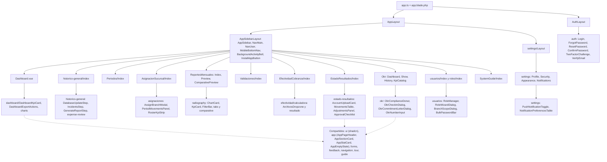

Carpetas de `resources/js`:

| Carpeta | Contenido |
|---|---|
| `pages/` | Páginas Inertia (diagrama). |
| `layouts/` | `AppLayout` → `app/AppSidebarLayout` o `AppHeaderLayout`; `AuthLayout` → `auth/AuthSimpleLayout`, `AuthCardLayout`, `AuthSplitLayout`; `settings/Layout`. |
| `components/ui/` | 27 componentes shadcn (button, card, dialog, sheet, calendar…). |
| `components/app/`, `forms/`, `feedback/`, `navigation/` | Bloques comunes: encabezado de página, tarjeta de sección, KPI, vacío, campos de formulario, confirmaciones, paginación. |
| `components/<módulo>/` | `estado-resultados` (~72), `okr` (~24), `usuarios` (~21), `historico-general` (~18), `asignaciones` (~14), `radiography`, `comparative`, `dashboard`, `efectividad`, `guide`, `tour`, `settings`. |
| `composables/` | `usePushNotifications`, `usePwaInstall`, `useTour`, `useToast`, `useConfirm`, `use*Index` por página, `estado-resultados/`. |
| `routes/`, `actions/`, `wayfinder/` | **Generados por Wayfinder** (no editar): helpers tipados por ruta nombrada y por acción de controlador. Se regeneran con `php artisan wayfinder:generate --with-form` o al compilar (plugin `wayfinder({ formVariants: true })` en `vite.config.ts`). |
| `config/mainNav.ts` | Menú lateral agrupado (Análisis, Operación, Administración, Ayuda y cuenta), filtrado por los módulos del rol (`auth.modules` compartido por `HandleInertiaRequests`). |
| `lib/`, `types/`, `styles/theme.css`, `tour/`, `tests/` | Utilidades (`routeLoadingOverlay`, `chart-theme`), tipos, tokens de diseño, recorrido guiado, pruebas Vitest. |

Sistema visual (fuente: `resources/js/styles/theme.css` y clases `app-*` de `resources/css/app.css`):

- Verde institucional `#047857` como `primary` (contraste AA con texto blanco); estados
  `success`/`warning`/`danger`/`info` con variantes `-soft` y `-border`; sombras `shadow-soft-*`;
  radio base 1 rem. En código nuevo usar **tokens**, no colores fijos (`bg-indigo-600`), para que
  el modo oscuro funcione.
- Tipografía `app-kicker`, `app-title`, `app-subtitle`, `app-section-title`, cuerpo 14 px, ayuda
  12 px, **nunca menos de 11 px**.
- Una acción principal por bloque; acciones peligrosas separadas y siempre con confirmación;
  todo control deshabilitado explica por qué.
- La pantalla de carga global solo aparece en navegaciones GET de más de 600 ms y en procesos
  largos; los formularios usan el estado de su botón. Errores 422 junto al campo.
- Accesibilidad: foco visible, Escape cierra modales, `prefers-reduced-motion`, botones de solo
  icono con `aria-label`. Probar a 390 px sin scroll horizontal.
- **Inputs numéricos**: en shadcn `Input` nunca combinar `:value` + `@input` (pierde dígitos en
  Chrome real); usar `model-value` u `OkrNumberInput` y probar con `npm run test:browser:okr`.
- En `<script setup>`, `watch()`/`watchEffect()` evalúan sus dependencias de inmediato: declara
  antes los `ref`/`computed` que usan (el build pasa pero revienta en ejecución).

Desarrollo: Vite en `127.0.0.1:5173` con `strictPort` (si el puerto está ocupado falla en vez de
moverse a 5174, lo que dejaba a `php artisan serve` apuntando a un puerto equivocado). Si aparece
una página de **otro** proyecto o 404 en todos los assets, revisa procesos huérfanos en los
puertos 8000/5173 (`netstat -ano`) y termínalos por PID.

---

## 15. Pruebas

| Suite | Cómo correrla | Notas |
|---|---|---|
| Pest (Unit + Feature) | `php artisan test` | `phpunit.xml`: SQLite `:memory:`, cache `array`, cola `sync`, mail `array`. ~1,250 pruebas: OKR ~278, ER ~228, Efectividad ~177, API ~126, radiografía/dashboard/alcance/periodos ~340. |
| Integración MySQL | `php artisan test --configuration=phpunit.integration.xml --testsuite=RadiographyIntegration` | Ver abajo. |
| Vitest | `npx vitest run` | 6 pruebas en `resources/js/tests/*.test.ts` (tema de gráficas y pestañas, overlays, `okrHttp`, `okrNumberInput`, `useOkrBaselinePreview`). Sin `vitest.config` propio: usa `vite.config.ts` y happy-dom. |
| Navegador OKR | `npm run test:browser:okr` | `tests/browser/okr-inputs/run.mjs`: Vite + Puppeteer teclean en Chrome real los escenarios A-F de los campos numéricos del asistente OKR. |
| Calidad | `npm run lint:check`, `npm run format:check`, `npm run types:check`, `composer run lint:check` (Pint) | `composer run ci:check` corre todo + Pest. |

Estructura: `tests/Feature` (~190 archivos: raíz, `Okr/`, `EstadoResultados/`, `Api/V1/`, `Auth/`,
`Efectividad/` con `Calculadora`, `V4`, `V12`, `Settings/`, `Notifications/`), `tests/Unit` (~30),
`tests/Integration` (16), `tests/Support` (fixtures sintéticos, p. ej.
`EstadoResultadosFixtures.php`), `tests/browser/`.

**Suite de integración (MySQL real)**: `RadiographySnapshotBuilder` y
`BranchRadiographyCalculator` usan `REGEXP`, `JSON_EXTRACT` y `JSON_UNQUOTE`, que SQLite rechaza
aun con tablas vacías; esta suite es la única que prueba el pipeline financiero y
`/reportes-mensuales/{period}/scoped-data` de punta a punta.

1. Copia `.env.testing.mysql.example` a `.env.testing.mysql`.
2. Crea una base **dedicada** (`CREATE DATABASE reportes_test;`), nunca la de desarrollo.
3. Ajusta `DB_TEST_HOST`, `DB_TEST_PORT`, `DB_TEST_DATABASE`, `DB_TEST_USERNAME`,
   `DB_TEST_PASSWORD`.
4. Migra: `php artisan migrate --database=mysql_testing --path=database/migrations --force`.
5. Corre la suite (comando de la tabla).

Sin `.env.testing.mysql` o sin conexión, esas pruebas quedan `skipped` (no rompen
`php artisan test`). Hay dos tipos: fixture sintética con `RefreshDatabase` sobre
`mysql_testing` (p. ej. `RadiographyMysqlPipelineTest`) y **solo lectura** sobre la BD real de
desarrollo con el trait `UsesRealDevDatabase` (`ScopedDataRealRosterTest`,
`WebExcelPdfDatasetConsistencyTest`), que nunca escriben ni usan `RefreshDatabase`.

Pruebas que dependen de libros reales (se saltan si no están en disco, que está ignorado por git):
`tests/Feature/Efectividad/Calculadora/EfectividadTulaParityTest.php` (`docs/ejemplosCorte/`) y
`tests/Feature/Efectividad/V12/EfectividadV12CordobaParityTest.php`
(`docs/efectividad/ultimaVersion/`). No borres esas carpetas del equipo de desarrollo.

Recomendaciones: no uses `pest --parallel` para validar (da fallos falsos). Para E2E con storage
aislado, `php artisan serve` ignora `LARAVEL_STORAGE_PATH`: usa `php -S` con `variables_order=
EGPCS` y verifica la ruta. Las validaciones financieras se hacen contra periodos reales (Abril
2026 = periodo 14, Junio 2026 = periodo 21) con las auditorías del catálogo.

---

## 16. Pendientes y bugs conocidos

Consolidado de la auditoría integral del 23-nov-2026 y de lo que sigue vigente de la del
12-oct-2026. Severidad: **C** crítico, **A** alto, **M** medio, **B** bajo.

### 16.1 Ya resuelto en el árbol actual (verificar al desplegar)

- Dependencias: `phpoffice/phpspreadsheet` 1.30.9, `laravel/framework` 13.43,
  `maatwebsite/excel` 3.1.70, `puppeteer` 25.18.
- `retry_after` 3700 en `config/queue.php` y `.env.example`; `UpdatePeriodDatabaseJob` reclama
  solo runs `queued`; `lockForUpdate` del periodo en «Actualizar BD» y «Generar radiografía».
- Archivos subidos en disco privado (`ReportUploadStorage`) + comando
  `reportes:mover-cargas-a-privado` (falta **ejecutarlo** en el VPS).
- Purga de caché vencida, `queue:prune-failed`/`prune-batches` programados; índices de
  rendimiento; ER «Procesar»/«Aprobar» en cola.
- `.github/workflows/tests.yml`: `run: |` multilínea y `composer audit` separado. CI en verde
  (tests y linter) desde el 23-nov-2026.
- Montos en texto con coma de miles («12,500») ya no se leen como decimal (12.5): regla única
  `App\Support\MoneyText` en Lendus cobranza, NOI y la nómina NOI del Estado de Resultados.
  Pruebas: `tests/Unit/MoneyTextTest.php`.
- Importaciones «a medias»: cada importación ya corre dentro de `DB::transaction`
  (`ReportAnalysisService::analyze`). Solo quedaría a medias con tablas MyISAM, por eso el
  despliegue exige InnoDB.
- Reglas de negocio que **se dejaron como están por decisión del dueño** (cambian cifras ya
  reportadas; validar con datos reales antes de tocarlas): las tres reglas de recuperación,
  gastos sin estatus o cancelados, conceptos de nómina que empiezan con «D», lista fija de
  sucursales en algunos puntos.

### 16.2 Urgente

| Sev. | Pendiente | Acción |
|---|---|---|
| C | Repositorio que fue público con datos reales en el historial | Privado + `git filter-repo` (11.3), purga de caché de GitHub, reclonar todo. Requiere autorización. |
| A | Respaldos solo manuales | Respaldo diario cifrado de BD + `storage/app` fuera del VPS y prueba de restauración mensual. |
| A | InnoDB en producción sin confirmar | Revisar motor de todas las tablas; en MyISAM las FK, transacciones y `lockForUpdate` no hacen nada. |
| A | CI estuvo en rojo desde el 16-oct (nunca llegaba a Pest) | Confirmar verde y exigirlo antes de desplegar. |

### 16.3 Backend

| # | Sev. | Dónde | Problema | Arreglo propuesto |
|---|---|---|---|---|
| B1 | C | `RadiographySnapshotBuilder` (~3824-3900, ~5147-5160) vs `BranchRadiographyCalculator::recoveryExclusionSql()` | Tres reglas de recuperación: la oficial (PAGO/DESCUENTO + 30 % CRECE), el detalle (excluye por `LIKE '%SEGURO%'` y descarta filas sin sucursal) y Efectividad (`transaction != 'CONDONACION'`, tira NULL). Una transacción nueva descuadra. | Una sola `RecoveryRules` + prueba global = Σ sucursal = detalle = efectividad. |
| B2 | A | `ReportUploadController` (~96, ~1728-1749) | Carga **todas** las cargas de la historia por periodo. | Cargar una vez e indexar; último run con `MAX(id) GROUP BY`. |
| B3 | A | `MonthlyReportController::persistFilteredRunExport` | Un **GET** de exportación filtrada marca el último run como `success` y borra versiones aunque el job corra. | Bitácora de descargas aparte; nunca tocar runs `queued/running` desde un GET. |
| B4 | A | `RadiografiaExportService` (~79-93) | Caché de 12 h ligada solo a `summary.updated_at`: reasignar un gestor no la invalida. | Firma de entradas (como `InputSignature` del ER) o `touch()` del resumen al reasignar. |
| B6 | M | Jobs de radiografía/BD/reproceso | Sin `failed()`; `WithoutOverlapping` sin `releaseAfter`: runs atascados en `running`. | `failed()` + `releaseAfter(60)` + comando que cierre runs vencidos. |
| B8 | M | `PeriodConsolidationService` (~29-96) | N+1 por empleado. | `distinct()`, precarga e inserción en bloque. |
| B9 | M | `DatabaseUpdateService` (~198), `GenerateRadiographyJob` (~196) | `catch (\Throwable)` que solo loguea: el run queda «éxito» con IMSS/rotación/OPEX desactualizados. | Advertencia visible en el run. |
| B10 | M | `MonthlyReportController` (varios) | Devuelve `$e->getMessage()` al usuario (puede exponer SQL); exports síncronos. | `TechnicalErrorReference` (como el ER) y exports en cola. |
| B11 | M | `RadiographySnapshotBuilder`, `PeriodEmployeeRosterService` | 4-5 copias de «qué period_ids leer» y `Period::all()` repetido. | `PeriodDataScope` único memoizado. |
| B12 | M | `RadiographySnapshotBuilder` (~31, ~1641) | Estado mutable: sin «calentar» antes devuelve **ceros silenciosos**. | Pasar ids por parámetro o lanzar excepción. |
| B15 | B | Varios | Lista de sucursales fija en ~10 archivos pese a `BranchRouteCatalog`; dinero en `double` en cartera V4; `JSON_EXTRACT(raw_payload,'$.credit_origin')` sin índice; jobs V4 muertos; `smalot/pdfparser: "*"` sin versión fija. | Catálogo único, `decimal(16,2)`, columna materializada, borrar código muerto, fijar versión. |
| — | M | Importadores | `GastosImportService`, `GastosLendusPdfImportService`, `ImssExcelImportService`, `RotacionExcelImportService`, Lendus ministraciones/directorio y `ColumnMapService` **sin pruebas**; Saldos por Cliente tarda ~267 s para 7,882 × 156 (`Excel::toArray()` carga todo en memoria). | Pruebas con archivos anonimizados; lector por streaming. |
| — | M | Efectividad / API | La web calcula con V12.9.4 sin guardar ejecuciones; `collections/effectiveness` (approved) solo entrega ejecuciones V4/V7 antiguas. | Decidir si la API debe exponer V12 (requiere persistir resultados) o retirar `approved`. |
| — | B | Efectividad | Decisión abierta: el DESCUENTO de refinanciamiento sobre la cuota exigible cuenta como cobranza. | Confirmar con negocio. |
| — | B | Datos | `branches.sucursal_id` vacío hasta correr `SucursalSeeder` → `sucursal: null` en la API. | Correr el seeder en cada instalación. |

### 16.4 Seguridad y API

| # | Sev. | Hallazgo | Arreglo |
|---|---|---|---|
| S3 | A | **Inyección de fórmulas** en Excel/CSV: `setCellValue()` con texto importado en `RadiographyWorkbookBuilder` (706 llamadas), `EstadoResultadosExcelExporter`, `DashboardExcelExporter`, `exportSummary`, `ApiCsv::cell()`. | Helper único: texto que empiece con `= + - @ \t \r` como `TYPE_STRING`. |
| S4 | M | `financial.read` basta para datos por colaborador en `/financial/employees/{id}` y `scope=employee`. | Exigir también `employees.read`. |
| S5 | M | `/people` deja `current_branch_id`/`sucursal` fuera del alcance de un consumidor restringido. | Ocultar si no está permitido. |
| S6 | M | Tokens sin expiración; el alta concede 6 abilities y modo global por defecto. | `expires_at`, rotación, alta explícita y modo que falle cerrado. |
| S7 | M | Sin protección contra bombas ZIP en cargas generales y del ER (Efectividad sí la tiene). | Reusar la inspección de `EfectividadExcelReader`. |
| S8 | B | Throttle después de `auth` (401 no cuenta); 404 vs 403 permite enumerar ids; `SESSION_SECURE_COOKIE` ausente en `.env.example`. | Ajustes puntuales. |
| — | B | API | Sobre de respuesta único `{data, meta}`, errores con `code` estable y `errors` por campo, `Cache-Control: no-store` en financieros, `ETag` en catálogos, política de deprecación antes de v2. |

### 16.5 UI

| # | Sev. | Dónde | Problema |
|---|---|---|---|
| U1 | M | `components/radiography/ChartCard.vue` + `lib/chart-theme.ts` | En modo oscuro las opciones de modo claro sobrescriben el tema (tooltip blanco, etiquetas oscuras). Dashboard, Comparativo, ER. |
| U2 | M | `components/asignaciones/AssignBranchModal.vue` | Modal casero sin `role="dialog"`, sin foco atrapado, Escape no cierra, X sin `aria-label`. |
| U3 | M | `pages/ReportesMensuales/Preview.vue` (~3,570 líneas) | 12 pestañas con `v-show` montan 25 gráficas al entrar; pestañas sin ARIA. Partir por pestaña con `defineAsyncComponent` + `KeepAlive`. |
| U4 | B | `useUserActions.ts`, `RoleManager.vue`, `OkrDocumentsPanel.vue` | SweetAlert con colores hex fuera de marca. |
| U5 | B | ~109 textos `text-slate-300/400`, ~170 de 9-10.5 px | Contraste < AA y tamaño bajo el mínimo de 11 px. |
| U6 | B | `OkrGestorTable.vue`, `DeleteUser.vue`, dialog/sheet | Fila clicable sin teclado; textos en inglés («Password», «Close»). |

Deuda visual: ~3,670 clases de color fijas contra ~100 usos de tokens; 6 tarjetas KPI distintas
(`KpiCard`, `DashboardKpiCard`, `ComparativeKpiCard`, `OkrStatCard`, `AppStatCard`, `KpiStrip`);
`AppPageHeader` en pocas páginas; 214 `any`. Archivos más grandes: `Preview.vue`,
`historico-general/index.vue`, `Periodos/Index.vue`, `EstadoResultados/Index.vue`,
`MovementsTable.vue`.

### 16.6 Otros pendientes conocidos

- OKR: 3 roles reales frente a los 4 niveles del documento de requisitos (Gerencial fusiona
  Dirección y Regional/Gerente); OKR corporativo/regional solo preparado (`parent_id`,
  `scope_type`); KPI manuales sin fuente automática.
- Comandos con defectos (lista al final de la sección 13).
- `VerifyDeploymentCommand::checkConfig()` lee `services.browsershot.chrome_path` (no existe; la
  clave es `pdf.browsershot.chrome_path`): siempre avisa «Sin ruta explícita». Tampoco avisa si
  existe `public/storage`.
- En Windows/WAMP no hay `pcntl`: un job colgado no se corta por timeout.
- Ingresos Cobranza con el formato de 14 columnas (sin Fecha transacción/Fecha cuota) no sirve
  para Efectividad: pedir el de 35 columnas.
- La tarea «Workflow Health» (diagnóstico real de procesos y botón «Solucionar error») no se
  inició.
- Comentarios de código y `.env.example` todavía citan archivos de `docs/*.md` retirados; su
  contenido vive en este manual.

### 16.7 Hoja de ruta sugerida

1. **Semana 1**: repo privado + purga del historial; CI en verde; helper anti-fórmulas en todos
   los exports; respaldo diario automático; ejecutar `mover-cargas-a-privado` y confirmar InnoDB.
2. **Semanas 2-3**: `RecoveryRules` única con prueba de cuadre; `PeriodDataScope`; ciclo de vida
   común de jobs; invalidación de caché por firma de entradas; exports pesados en cola.
3. **Mes 2**: partir `RadiographySnapshotBuilder`, `RadiographyWorkbookBuilder` y los
   controladores grandes; pruebas de importadores; suite de integración en CI contra MySQL.
4. **Meses 2-3 (UI)**: tema oscuro de gráficas, una sola tarjeta KPI, `AppPageHeader` en todas
   las páginas, dividir `Preview.vue`, barrido de colores a tokens.

---

## 17. Glosario de negocio

| Término | Significado en el sistema |
|---|---|
| **Radiografía** | Reporte financiero mensual del periodo (global, por sucursal y por colaborador) con Excel y PDF. Se guarda en `period_summaries`. |
| **Mes operativo / periodo** | Periodo de cuatro semanas lunes-domingo (28 días, 20 jornadas) usado por MR LANA; único que recibe archivos. |
| **Mes natural** | Del día 1 al último del mes; solo en la API, armado por fecha de cada registro. |
| **Sucursal / branch / ruta** | `branches` son oficinas o rutas operativas (13 oficiales); `sucursales` son las 11 institucionales de OKR (regiones Q1 y Q3). Una sucursal agrupa varias rutas (`BranchRouteCatalog`). |
| **Corporativo** | Unidad no operativa: no coloca ni cobra; su nómina (hoja «SIN ASIGNAR») resta al consolidado y sus gastos se excluyen del OPEX de sucursal. Recibe los excedentes. |
| **Gestor / promotor / colaborador** | Persona de campo que coloca y cobra; en Lendus aparece como promotor (`promoter_name`, `promoter_code`). |
| **Colocación** | Monto prestado en el periodo (DESEMBOLSO + REFINANCIAMIENTO de «Ministraciones»). KPI bruto; el seguro es informativo. |
| **Recuperación / ingresos de cobranza** | Lo cobrado: PAGO y DESCUENTO de «Ingresos Cobranza», sin seguros, con CRECE al 30 %, sin unificación ni condonación. Componentes: capital, interés, IVA, cargos, comisión de apertura… |
| **Cartera / valor de cartera** | Saldo de los contratos al cierre según «Saldos por Cliente». |
| **Cartera vencida / mora** | Contratos con días de atraso (DPD) > 0, por buckets 0-30 … 120+. **Mora %** = vencida ÷ cartera. |
| **DPD** | Días de atraso (*days past due*); depende de la fecha de corte. |
| **Préstamo activo** | Capital de contratos al corriente. |
| **OPEX** | Gasto operativo: ERP (filtrado por sucursal) + Lendus, sin fondeos, excedentes, pólizas ni nómina. |
| **Nómina y Capital Humano** | Percepciones NOI netas + IMSS patronal + gastos de nómina de empleados (gasolina, finiquitos, médicos, motos reclasificados). |
| **EBITDA** | En la radiografía: ingreso base − (OPEX + Nómina y Capital Humano) por sucursal; consolidado = Σ sucursales + aporte corporativo. En el ER: Ingresos − OPEX total (un solo EBITDA). |
| **EBIT / EBT / Utilidad neta** | ER: EBITDA − depreciación y amortización; + resultado financiero neto; − ISR. |
| **Margen EBITDA** | EBITDA ÷ ingreso base (venta real). Categoría de sucursal o gestor según el margen (JUNIOR, SENIOR…). |
| **Fondeo / préstamos intersucursales** | Dinero que una sucursal presta a otra (`interbranch_loans`); informativo, no es OPEX. |
| **Excedentes** | Utilidad que las sucursales envían a corporativo; cuenta bancaria de excedentes en el ER. |
| **CRECE** | Producto/seguro cuya cobranza se reconoce solo al 30 % (pólizas CRECE 30 %). |
| **Savehearts / Comadres** | Seguros que vienen dentro de Ingresos Cobranza (`is_savehearts`); se excluyen de la recuperación. |
| **Seguros puente** | Seguros que pasan por gastos de Lendus (pólizas); informativos. |
| **Unificación / reestructura / refinanciamiento / condonación** | Operaciones de Lendus que cambian el contrato; la unificación y la condonación no son recuperación. |
| **NOI / NOI fiscal** | Sistema de nómina: «NOMINANUEVA» (percepciones/deducciones) y «NOMINAF» (fiscal, base de IMSS y rotación). Clave NOI = `employee_code` (no única). |
| **IMSS** | Cuota patronal derivada de NOI fiscal (`fact_imss`, colaboradores × cuota mensual). |
| **Rotación** | Índice por sucursal = bajas ÷ promedio de personal, derivado del roster NOI (`fact_rotacion`). |
| **Roster** | Plantilla canónica del periodo (altas, bajas, activos) en `period_employee_rosters`. |
| **Lendus** | Sistema de crédito: Ministraciones (colocación), Ingresos Cobranza, Saldos por Cliente (cartera y fotografías diarias), gastos (PDF/Excel) y directorio de empleados. |
| **ERP** | Sistema administrativo de gastos (`gastos_erp`); base de la conciliación del ER. |
| **DG** | Dirección General: sus gastos y remuneración se ven solo con `estado_resultados,ver_dg`. |
| **LEROM / BBVA** | Créditos de la empresa cuyos intereses (gastos financieros del ER) salen de la tabla de amortización. |
| **Efectividad de cobranza** | Cobrado ÷ Sano por cobrar del periodo (V12.9.4), con aportes de Sano, Atraso y Vencido; sin tope. |
| **Sano / Atraso / Vencido** | Buckets de la cobranza: cuota a tiempo, cuota ya vencida del contrato vigente, contrato ya vencido. |
| **Fotografía de cartera** | «Saldos por Cliente» descargado al cierre de cada día (domingo base … domingo de corte). |
| **PRELIMINAR / CONCILIADO** | Estado del reporte de Efectividad: con o sin metas inferidas, diferencias o desapariciones por revisar. |
| **OKR / KR** | Objetivo cualitativo y resultados clave cuantificados (KPI, base, meta, peso). |
| **Check-in** | Seguimiento semanal de un OKR con bloqueos y acciones correctivas. |
| **Carta Compromiso / Warning** | Documentos PDF con folio: compromiso de metas del colaborador y aviso por incumplimiento comprobado. |
| **Consumidor API** | Sistema externo con token Sanctum (Auditoría Operativa, MR. LANA PEOPLE). |
| **Alcance (scope)** | General, sucursal o colaborador; restringe datos en web y API. |
